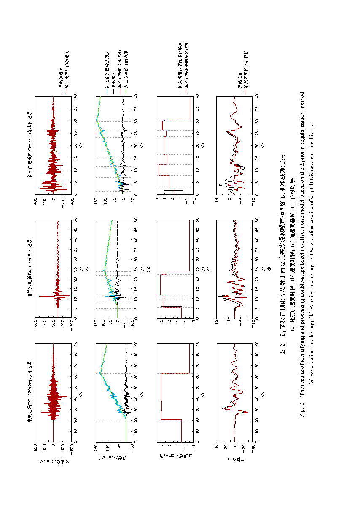
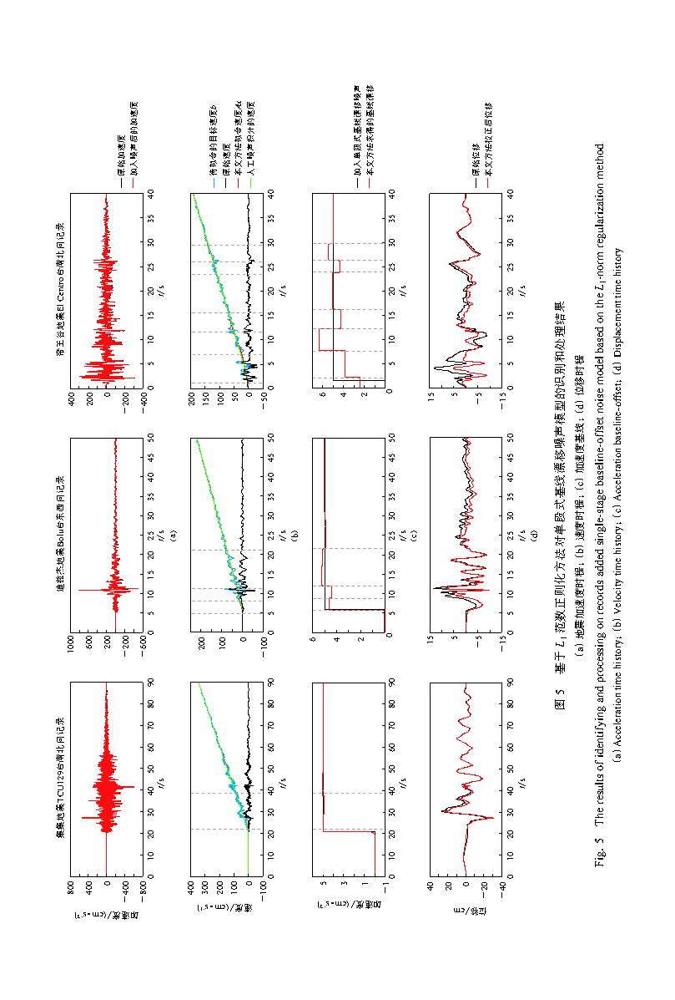
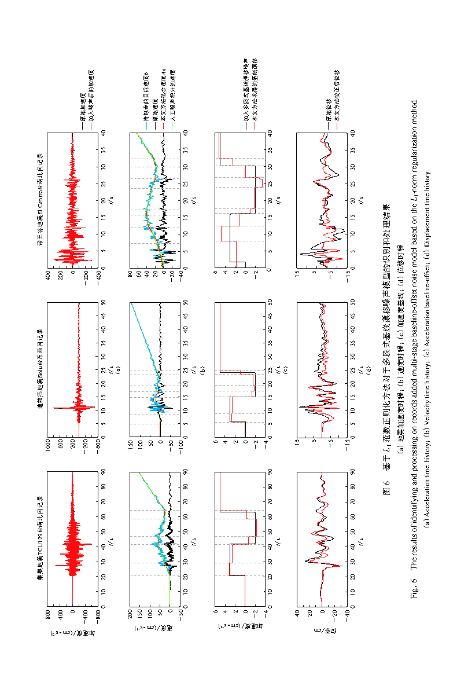
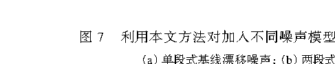

# 基于 L1 范数正则化的强震动加速度记录基线漂移识别方法 — 逐节精读

> 说明：本文为中文文献，故采用"原文摘录 + 逐节解读"的双栏结构（本目录下的 `translation_notes.md` 记录了该模式的取舍）。原文引用用于定位证据，解读用于解释方法与结论。

## 文献信息

| 项目   | 内容                                    |
| ---- | ------------------------------------- |
| 标题   | 基于 L1 范数正则化的强震动加速度记录基线漂移识别方法          |
| 作者   | 熊政辉、李小军、戴志军、陈苏                        |
| 单位   | 中国地震局地球物理研究所；中国地震风险与保险实验室             |
| 期刊   | 地震学报，2019，41(1)：111–123               |
| DOI  | 10.11939/jass.20180072                |
| 本地文件 | `参考文献/基于L1范数正则化的强震动加速度记录基线漂移识别方法.pdf` |
| 阅读状态 | 全文覆盖（摘要、引言、方法、试验、结果、结论）；参考文献列表未展开     |

## 阅读导航

- 摘要与问题定位 — p.1（S001–S002）
- 引言：漂移的危害与传统方法的主观性 — p.2–3（S003–S006）
- 第 1 节 L1 范数正则化 — p.3–4（S007–S011，E001）
- 第 2 节 数据与噪声模型 — p.4–6（S012–S015，T001，F001）
- 第 3 节 结果与分析 — p.6–8（S016–S020，F002–F006）
- 第 4 节 讨论与结论 — p.11–12（S021–S024，F007）

## 公式索引

- [E001 · 式 (1)](#E001) — p.4，L1 范数正则化目标函数

## 术语表

| 规范术语 | 英文/符号 | 说明 |
|---|---|---|
| 基线漂移 | baseline drift | 加速度零线的偏移；文中假设为分段恒定的阶梯函数 |
| 事前部分 | pre-event part | P 波到时之前的记录段，由 STA/LTA 拾取确定 |
| 分段线性拟合 | piecewise linear fitting | 对速度时程分段拟合直线，由斜率反推加速度基线 |
| 正则化参数 | $\lambda$ | 平衡拟合误差与稀疏约束；文中取 1 |
| 字典矩阵 | $A$ | 把待求基线映射为速度拟合量的线性算子 |
| 稀疏解 | sparse solution | 大多数分量为零的解，对应少数漂移段 |
| 单段式/两段式/多段式 | single-/double-/multi-stage | 三类人工基线漂移噪声模型 |

## 正文

### 摘要与问题定位（p.1）

**Source:** p.1 S001

**原文:** 本文提出了一种基于 L1 范数正则化的基线校正新方法，即以拟合速度时程误差最小为目标，以基线漂移本身尽可能小为约束条件，经过凸优化多次迭代自动求解出满足条件的基线漂移，避免了人为选取基线漂移分段次数和基线漂移起止时刻的主观干扰；随后利用该方法对多组加入了基线漂移噪声模型的强震动加速度记录进行验证。

**解读:** 这是全文的目标句：把"选分段"这一主观动作交给凸优化，目标函数由两部分组成——速度拟合误差尽量小 + 基线漂移尽量小。注意"基线漂移尽可能小"在本文英文姊妹篇中被进一步明确为对基线**差分**的 L1 惩罚（即跳变次数少），这是它得到阶梯状漂移解的数学根源。

**Source:** p.1 S002

**原文:** 结果表明：本文方法对于识别和处理单段式、两段式和多段式的基线漂移噪声具有普适性，能敏锐地捕捉到速度时程发生漂移的趋势（斜率变化），无需预先设定加速度基线漂移模型也可有效地识别出多种基线漂移噪声的起止位置和漂移程度；地震记录事前部分对本文方法处理结果影响较大，当记录事前部分足够长时（如 20 s），识别基线漂移噪声的准确性较高，位移时程可以较好地与原始位移匹配；而对于发生漂移的速度时程，本文方法可以不受地震事前部分长短的干扰，甚至在加速度记录出现明显丢头现象时，也能很好地实现峰值速度和整个速度时程的恢复。

**解读:** 摘要已经把最重要的实验结论说完了：适用性（单/两/多段）+ 敏感性（对速度漂移趋势）+ 依赖条件（事前部分长度决定位移恢复；速度恢复不受影响，即使丢头）。这三条构成了阅读全文的检查表。

### 引言：漂移的危害与传统方法的主观性（p.2–3）

**Source:** p.2 S003

**原文:** 而强震动加速度记录中往往会存在基线漂移（Iwan et al，1985；Boore，2001；周宝峰等，2013），Chiu（1997）指出微小的加速度漂移会导致积分得到的速度和位移产生巨大的数值误差，例如 0.01 cm/s2 加速度漂移在持时为 60 s 时，积分得到的速度会有 0.6 cm/s 的误差，得到的最终位移误差可达到 18 cm。

**解读:** 这是全文的动机来源：0.01 gal 级的漂移在两次积分后放大成 18 cm 的位移误差，因此基线校正对永久位移、近断层地震动研究是必需步骤，而不是可选的预处理。

**Source:** p.2–3 S004

**原文:** 现今通用的基线校正方法中，一般假设加速度在某个给定的时间段内发生基线漂移，且给定了基线漂移的次数。这些参数往往是凭借主观经验给定的。通常根据对原始记录积分得到速度时程的漂移情况进行判断，然后运用分段线性拟合速度的方法，获得加速度时程的基线漂移。但在分段拟合时如何确定分段次数和分段点位置，即加速度在什么时间段内发生偏移，往往需要人为进行选择。

**解读:** 这是作者要攻击的痛点：分段数、分段点位置都靠人判断，因此方法难以标准化与自动化。整篇文章的贡献就落在这两个参数上——把它们交给稀疏优化自动决定。

**Source:** p.3 S005

**原文:** 以基线漂移初始时刻的选取为例，最为常用的有两种方式：一是认为基线漂移主要受强震仪的仪器响应影响，发生在加速度大于 50 cm/s2 的初始时刻；二是认为基线漂移主要受到地面初始震动影响，发生在地震波 P 波到达的初始时刻。导致加速度漂移的因素繁多且随机性强，不仅会产生低频误差（包括仪器噪声、背景噪声、初始值等），还会因地面扭转和倾斜导致仪器倾斜，因此很难清楚地确定加速度漂移所发生的具体时刻。

**解读:** 作者明确指出漂移成因包含"低频误差"与"仪器倾斜"两类，这与 2022 年综述的分类完全一致。读懂这一点，就理解为什么单轴方法无法直接照搬到三轴：水平分量的倾斜效应和垂直分量差别很大。

**Source:** p.3 S006

**原文:** 为此，本文拟运用凸优化中的 L1 范数正则化方法，求得满足条件的加速度基线漂移最优解，即以分段线性拟合速度时程的方差与求解的基线漂移的绝对值之和最小为目标，不再人为选取基线漂移的起止时刻点，尝试获得一种适用性更为广泛的基线校正方法。

**解读:** 引言最后一行就是方法的形式化预告："分段线性拟合速度时程的方差 + 基线漂移的绝对值之和"。中文版把正则项写成绝对值之和，英文版进一步把它落实为差分 $y$ 的 L1 范数。

### 第 1 节 L1 范数正则化（p.3–4）

**Source:** p.3 S007

**原文:** L1 范数则表示某个向量中所有元素绝对值的和，它可以有效地实现稀疏表示（sparse representations），防止数据过拟合，有利于特征选取，通过不断迭代优化去掉数据中无效信息的特征，把这些特征对应的权重置为零；此外其模型结构也相对简单，更具有"可解释性"。

**解读:** 作者用"稀疏表示"来解释 L1 的作用：稀疏 = 大多数分量为零。对应到基线问题，"大多数时刻的基线跳变为零"就意味着只在少数时刻发生漂移，这正好匹配物理假设。

**Source:** p.3–4 S008

**原文:** L1 范数正则化是双准则式（即保证拟合残差 Ax−b 较小的同时，也使得向量 x 尽可能小），残差用 Euclid 范数（‖Ax−b‖2）度量，而正则化用 L1 范数（‖x‖1）进行（Boyd，Vandenberghe，2004）。

**解读:** 这是"双准则（bi-criterion）"的表述：既要拟合得好，又要解足够"干净"。理解这一对张力，就理解了 $\lambda$ 的作用与后续敏感性研究的必要性。

**Source:** p.3–4 S009

**原文:** 式中，A∈Rm×n 为字典矩阵，b∈Rm 为拟合的目标，λ（λ＞0）为正则化参数，x∈Rn 为所求最优解（稀疏解）。

**解读:** 该式给出了三个核心对象：字典矩阵 $A$、拟合目标 $b$、待求稀疏解 $x$。本文正文未给出 $A$ 的元素级构造，这是复现时必须自行补齐的关键点——英文姊妹篇把它称为"完备字典（稀疏表示）"，并在具体实现中把正则项作用在差分上。

**Source:** p.4 E001 · 式 (1)

$$
\min_x f(x) = \|Ax-b\|_2 + \lambda\|x\|_1
$$

**中文说明：** 式 (1) 即本文的核心优化问题：第一项为速度拟合残差的欧氏范数，第二项为 L1 正则项，$\lambda>0$ 平衡两者。英文姊妹篇（Dai et al., 2020）把第二项明确写成基线差分 $y$ 的 L1 范数 $\|y\|_1$，从而保证解为分段恒定（阶梯状）基线——复现时建议以英文版为准。

**Source:** p.4 S010

**原文:** 式（1）所求问题是最小绝对值收敛和选择算子（LASSO）的另一种等价表现形式（Tibshirani，1996），也可以看作是加了约束（λ‖x‖1）的最小二乘拟合方法。这是一种非常典型的凸优化形式，由凸优化理论分析可知，式（1）有且只有一个全局最优解（Boyd，Vandenberghe，2004）。

**解读:** 两个要点：一是该问题等价于 LASSO；二是凸性保证全局最优解唯一。对于要扩展到三轴的人来说，这意味着只要目标函数保持凸（例如把三维差分堆叠后用组稀疏惩罚），唯一最优解的性质依然成立——这是三轴扩展在数学上"安全"的前提。

**Source:** p.4 S011

**原文:** 由于基线漂移受多种因素的综合影响，本文认为：① 加速度基线发生漂移是随机的、预先无法确定漂移次数的；② 某一时刻基线发生漂移后会保持不变，在另一时刻发生突变后一段时间内继续保持不变，即加速度漂移是时间的分段线性函数（阶梯函数）；③ 地震动结束后速度尽量为零。……即在式（1）中设 b 为待拟合的速度，x 为所需求解的基线漂移。然后运用 MATLAB 中 CVX 凸优化工具包来求解 x。……本文设置正则化参数 λ 为 1。

**解读:** 三条假设是全文的物理基础（随机性、阶梯性、尾部速度归零），$b$ 与 $x$ 的赋值关系是建模的关键，$\lambda=1$ 则是人为固定值而非优化得到的值——这三点在复现时都要一一对应地落实，其中 $\lambda=1$ 是最值得做敏感性分析的地方。

### 第 2 节 数据与噪声模型（p.4–6）

**Source:** p.4–5 S012

**原文:** 本文选用 Akkar 和 Boore（2009）在讨论基于蒙特卡罗方法识别典型基线漂移噪声模型的基线校正方案中所采用的地震记录，以及工程应用上最为常用的 El Centro 波，作为测试基于 L1 范数正则化基线校正方法识别人工基线漂移噪声的原始地震记录。……本文仅以 1999 年中国台湾集集地震 TCU129 台南北分量，1999 年土耳其迪兹杰（Duzce）地震 Bolu 台东西分量和 1940 年美国帝王谷（Imperial Valley）地震的 El Centro Array #9 台的南北分量（即 El Centro 波）为例。

**解读:** 试验设计是"真实记录 + 已知人工噪声"的受控实验。三条记录的选择不是随机的，而是刻意让事前部分长度拉开差距，这一点在表 1 中最清楚。

**Source:** p.5 T001

**原文:** 表 1 本文所列地震记录信息（PEER，2013）

| 发震年 | 地震 | $M_W$ | P 波到时/s | 持时/s | 分量方向 | 台站名称 | 场地类型 | 震中距/km |
|---|---|---|---|---|---|---|---|---|
| 1940 | 帝王谷地震 | 6.95 | 0.04 | 40 | NS | El Centro Array#9 | D | 12.99 |
| 1999 | 迪兹杰地震 | 7.14 | 5.39 | 56 | EW | Bolu | D | 41.27 |
| 1999 | 集集地震 | 7.62 | 20.65 | 90 | NS | TCU129 | C | 14.16 |

**解读:** 该表是全文最重要的对照表：事前部分（P 波到时）分别为 0.04 s、5.39 s、20.65 s，正好覆盖"无事前部分—较短—充足"三个档位。作者的结论"事前部分越长越准"就由这三条记录支撑。

**Source:** p.5–6 S013

**原文:** 本文选择单段式、两段式和多段式的加速度基线漂移噪声模型。……其中，单段式噪声模型在加速度记录的 [t1，te] 区间漂移量 af 保持为 5 m/s2；两段式噪声模型在加速度记录的 [t1，t2] 区间漂移量 am1 保持为 5 m/s2，在 [t2，te] 区间漂移量 af 保持为 −2 m/s2；多段式（三段）噪声模型在 [t1，(t1＋t2)/2] 和 [(t1＋t2)/2，t2] 区间的漂移量 am1、am2 分别为 2 m/s2 和 −2 m/s2，在 [t2，te] 区间的漂移量 af 保持为 5 m/s2。

**解读:** 三类噪声的差别在于分段数与跳变符号。阅读时请以原文图 1 为准确认单位标注（正文文本层写作 m/s²，而按该领域惯例与图轴量级应为 cm/s²；这是原文排印/文本层的问题，不影响方法理解，但复现时务必先确定单位）。

### 图 1 典型加速度基线漂移噪声模型

**Placed near:** p.5 S013
**Source:** p.5 C001

**Original caption:** Fig. 1. Representative sketches of acceleration baseline-offset noise models (modified from Akkar, Boore, 2009).

**中文图注:** 图 1 本文采用的典型加速度基线漂移噪声模型（修改自 Akkar，Boore，2009）。$t_b$、$t_e$ 为记录起止时刻，$t_1$、$t_2$ 为加速度绝对值首次与末次超过阈值（50）的时刻，$t_3$ 为 $[t_1,t_2]$ 的中点，$a_{m1}$、$a_{m2}$ 为强震段漂移幅值，$a_f$ 为最终漂移幅值。

**Reading note:** 三个子图分别是单段、两段、三段模型；横轴为时间，纵轴为基线漂移量。看清新号：$t_1$ 起漂、$t_2$ 处二次跳变、$t_e$ 记录结束。

### 第 3 节 结果与分析（p.6–8）

**Source:** p.6 S014

**原文:** 在对集集地震 TCU129 台站南北向记录、迪兹杰地震 Bolu 台站东西向记录和帝王谷地震 El Centro 台站南北向记录加入两段式基线漂移噪声后，加速度时程的变化并不明显（图 2a），但通过加速度积分得到的速度时程出现了明显漂移（图 2b），对速度时程再次积分得到的位移时程漂移会更大。

**解读:** 这一句解释了"为什么不能在加速度域用肉眼发现漂移"：漂移在加速度上微不足道，却在一重积分后变成线性趋势、两重积分后变成抛物线趋势。这就是必须用速度域拟合的原因。

### 图 2 两段式基线噪声模型的识别与处理结果

**Placed near:** p.6 S014
**Source:** p.7 C002

**Original caption:** Fig. 2. The results of identification and processing of the double-stage baseline-offset noise model based on L1-norm regularization method. (a) Acceleration time history; (b) Velocity time history; (c) Acceleration baseline-offset; (d) Displacement time history.

**中文图注:** 图 2 基于 L1 范数正则化方法对两段式基线噪声模型的识别和处理结果：(a) 加速度时程；(b) 速度时程；(c) 加速度基线；(d) 位移时程。

**Reading note:** 该图在 PDF 中为横排整版图，图注为竖排文本，自动紧裁不可靠，故提供整页渲染 `assets/pages/p07.png`。重点看 (c)：识别出的基线（红线）与人工加入的噪声（黑线）是否重合。

**Source:** p.6 S015

**原文:** 对于 TCU129 台南北向记录，利用本文方法处理得到的基线漂移几乎与加入的已知噪声模型完全吻合；Bolu 台东西向记录处理得到结果在基线两次发生漂移的时刻点都吻合得很好，基线漂移程度在一段很短的时段有 −1.1 m/s2 的偏差；而 El Centro 台南北向记录处理得到的结果略有偏差，在基线第一次发生漂移的起始位置大约滞后了 0.5 s，基线漂移程度最大偏差为 ＋1.3 m/s2，但在第二次漂移时，位置和漂移程度均能准确吻合。

**解读:** 三条记录的误差从小到大依次为 TCU129 < Bolu < El Centro，与事前部分长度顺序完全一致。这是全文最直接的因果叙事：精度差异不来自算法随机性，而来自记录条件。

**Source:** p.6 S016

**原文:** 如图 3 所示，从 PEER 下载的 El Centro 台南北向记录明显缺乏事前部分，且其初始记录部分并不为零（如黑线所示，前 0.8 s 内均值为 5.8 m/s2，前 2 s 均值为 8.3 m/s2）。而使用本文方法处理时，得到该初始部分的基线漂移为 2.4 m/s2（图 3 中红线），即本文方法在处理缺乏足够事前部分且其初始记录部分不为零的加速度记录时，会造成地震记录的事前部分尽量靠近零线（图 3 的绿线）。

**解读:** 这是失真的机制：算法知道"地震前基线应为零"，于是强行把非零的初始段拉向零线，顺便带走了部分真实信号。理解这一点对三轴扩展尤其重要——垂直分量的初始值/永久位移不能被随意拉回零。

**Source:** p.6 S017

**原文:** 为进一步探讨基线识别偏差引起的位移时程变化，对本文方法识别出来的基线漂移与已知的基线漂移噪声模型差值（即处理后的加速度减去加入噪声的加速度）进行分析处理，将差值积分后得到速度差值，然后再积分得到位移差值，结果如图 4 所示，由于加速度基线差值是不规则的分段函数，其分段的大小和持续时间不同，经过两次积分得到位移的差值与加速度差值的正负关系不完全相匹配，具有一定的"滞后"性。

**解读:** 这一段解释了"小误差为什么变成大位移偏差"：误差是不规则分段函数，两次积分后其符号与幅值关系不再直观，表现成滞后。做三轴时，这种滞后会在矢量合成中产生方向性偏差。

**Source:** p.8 S018

**原文:** 对于 El Centro 台南北向记录，本文方法在识别其加速度基线发生漂移的起始时刻大约滞后了 0.5 s，基线漂移程度最大偏差为 ＋1.4 m/s2，其原因也是 El Centro 台南北向记录事前部分的缺失，且初始记录部分的加速度值不为零（图 3）。

**解读:** 单段式下的误差量级与两段式一致，说明"事前部分缺失"是系统性误差源，而非某种噪声模型的偶然结果。

**Source:** p.8 S019

**原文:** 多段式是加速度基线漂移模型中较为复杂的模式，本文方法能敏锐地捕捉到速度时程发生漂移的趋势（斜率变化），其表现为速度拟合分段次数更多，如图 6c 所示，每两条灰色虚线之间即为一次分段拟合，更准确地拟合出发生漂移的速度时程。而由于加速度基线漂移由分段线性拟合的速度所间接求得，因此得到的加速度基线漂移段数也会更多（图 6d）。

**解读:** 多段式案例最能体现方法的优点：分段数是自动增加的，而不是预设的。灰虚线是阅读图 5、图 6 的关键——每条虚线代表一次拟合段的切换。

**Source:** p.8 S020

**原文:** El Centro 台南北向原始记录积分得到的 PGV 为 −29.66 cm/s，本文方法在处理加入单段式、两段式和多段式加速度基线漂移噪声模型后的数据得到的 PGV 分别为 −30.66，−30.66 和 −30.53 cm/s。

**解读:** 这是全文最硬的定量结果之一：即使记录几乎丢头，三种噪声模型下 PGV 恢复误差也只有约 1 cm/s（约 3%）。速度恢复稳健、位移恢复依赖事前部分，是本文结论的核心对比。

### 图 3 El Centro 台初始部分处理结果

**Placed near:** p.8 S016
**Source:** p.8 C003

**Original caption:** Fig. 3. Comparison of the original record with the results processed by the new method in the pre-event portion of El Centro NS components record.

**中文图注:** 图 3 El Centro 台南北向初始部分记录处理结果：黑线为原始加速度，红线为方法所得加速度基线，另一条为校正后加速度。

**Reading note:** 该裁切为近似框（图 3 与图 4 位于同页相邻位置，自动定位精度有限）；精确对照请看 `assets/pages/p08.png`。重点看绿色曲线被拉向零线的过程。

### 图 4 识别基线与加入噪声的差值

**Placed near:** p.6 S017
**Source:** p.8 C004

**Original caption:** Fig. 4. The difference between baseline-offset identified by this paper and added two-stage noise model for El Centro NS component.

**中文图注:** 图 4 本文方法所识别的 El Centro 台南北向记录与加入两段式噪声模型后的基线漂移噪声差值（含加速度差值、速度差值、位移差值）。

**Reading note:** 该图是"误差如何被两次放大"的直接证据：加速度差值很小，位移差值却可达数十（单位见原图轴标注）。

### 图 5 单段式噪声模型的识别与处理结果

**Placed near:** p.8 S018
**Source:** p.9 C005

**Original caption:** Fig. 5. The results of identification and processing of the single-stage baseline-offset noise model based on L1-norm regularization method. (a) Acceleration time history; (b) Velocity time history; (c) Acceleration baseline-offset; (d) Displacement time history.

**中文图注:** 图 5 基于 L1 范数正则化方法对单段式基线噪声模型的识别和处理结果：(a) 加速度时程；(b) 速度时程；(c) 加速度基线；(d) 位移时程。

**Reading note:** 与图 2 同构，只是噪声模型换为单段式；此图为横排整版，故提供整页渲染。

### 图 6 多段式噪声模型的识别与处理结果

**Placed near:** p.8 S019
**Source:** p.10 C006

**Original caption:** Fig. 6. The results of identification and processing of the multi-stage baseline-offset noise model based on L1-norm regularization method. (a) Acceleration time history; (b) Velocity time history; (c) Acceleration baseline-offset; (d) Displacement time history.

**中文图注:** 图 6 基于 L1 范数正则化方法对多段式基线噪声模型的识别和处理结果：(a) 加速度时程；(b) 速度时程；(c) 加速度基线；(d) 位移时程。

**Reading note:** 重点看 (b)、(c) 中的灰色虚线分段：分段数量明显多于图 5，是"自动选段"能力最直观的展示。

### 图 7 El Centro 台不同噪声模型下的速度恢复

**Placed near:** p.8 S020
**Source:** p.11 C007

**Original caption:** Fig. 7. Velocity trace recovered from El Centro NS component records with different noise models by the method proposed in this paper. (a) Single-stage baseline drift noises; (b) Double-baseline drift noises; (c) Multi-stage baseline drift noises.

**中文图注:** 图 7 利用本文方法对加入不同噪声模型后的 El Centro 台 NS 向记录进行恢复的结果：(a) 单段式；(b) 两段式；(c) 多段式基线漂移噪声。

**Reading note:** 这是"速度恢复稳健"结论的证据图；三条曲线（原始速度、本文方法速度、校正后速度）应高度重合。

### 第 4 节 讨论与结论（p.11–12）

**Source:** p.11 S021

**原文:** 相比于 Iwan 等（1985）提出的两段式方法和 Boore（2001）提出的 υ0 方法及其改进方法，本文所提出的基于 L1 范数正则化的加速度基线漂移识别方法，运用加入 L1 范数正则化的最优化思想，以拟合速度误差尽可能小为目标并以加速度基线漂移稀疏为约束条件，通过凸优化技术多次迭代求解，自动计算出合适的加速度基线漂移分段数量，并计算其漂移时刻和漂移程度，因而减少了加速度基线校正中人为干预选择的主观性，拓展了基线校正方法的通用性。

**解读:** 与其他方法的关系定位：Iwan 方法与 Boore υ0 方法都需要预设分段或依赖某个时间节点，L1 方法则把"分段数量"变成优化结果。审视三段式与多段式结果时，这就是它的差异化优势。

**Source:** p.11 S022

**原文:** 1）地震加速度记录保留足够长的事前部分（pre-event portion）是十分重要的……通常符合标准要求的地震记录会留有大约 20 s 的事前部分……而当地震加速度记录事前部分过短（明显的丢头现象）且不为零时，本文方法会把加速度往零线"拉拢"，这在一定程度上会造成恢复后的位移略微偏小。

**解读:** 结论 1 给出的是使用条件，而不是方法缺陷：方法本身要求事前部分足够长；丢头 + 非零初始会引入"拉向零线"的系统偏差。对三轴扩展来说，这条约束要逐分量检查。

**Source:** p.11 S023

**原文:** 2）本文所采用的加速度基线校正方法适用于单段式、两段式和两段式的加速度基线漂移，不用预先设定基线漂移模型即可自动识别基线漂移类型。……本文方法可以更为敏锐地察觉速度漂移的趋势（斜率）变化……特别是在多段式基线漂移噪声中，对速度拟合的分段次数会更多，由此得到的基线漂移次数也会随之增加。但是由于本文方法采用了 L1 范数正则化，其稀疏性特征可以很好地控制基线漂移的次数和大小。

**解读:** 结论 2 说明方法的适应性与自控性：分段数会随信号复杂度增加，但 L1 稀疏性会抑制过度分段。$\lambda$ 越大，分段越少、越保守——这正是三轴扩展中需要重新标定的参数。

**Source:** p.11–12 S024

**原文:** 3）本文方法可以较好地恢复加速度基线漂移后的速度时程和位移时程。无论地震加速度记录是否有足够的事前部分，本方法都可以很好地恢复峰值速度值，且对于整个速度时程也有很好的恢复效果。……正则化参数 λ 是一个模型相关的超参数，不同的 λ 取值会直接影响凸优化求解的基线漂移结果，但如何获取合适的超参数值一直是个难题和挑战。后续工作将运用本文方法对更多的实际强震动数据进行处理，并对正则化参数 λ 的取值进行研究。

**解读:** 结论 3 把"速度"和"位移"分开评价：速度恢复几乎不受事前部分影响，位移恢复高度依赖。最后提出的 $\lambda$ 取值问题，是作者留给自己也是留给后续研究（包括你的三轴工作）的开放问题。

## 阅读提示（critical reading notes）

1. 本文的核心创新是"用稀疏优化替代人工分段"，但正文没有给出字典矩阵 $A$ 的显式构造与 CVX 代码级细节，复现需要结合英文姊妹篇（Dai et al., 2020）中"$y_i=x_{i+1}-x_i$ 且 $y$ 稀疏"的形式来补全。
2. 三条记录的主要差异是事前部分长度，因此"事前部分越长越好"的结论虽然直观，但样本量极小（每种噪声模型各三条记录），推广到海量数据前需要更多统计验证。
3. 论文中加速度漂移幅值/阈值的单位标注在文本层写作 m/s²，而按图轴量级与该领域惯例应为 gal（cm/s²），复现前请以原图标注为准。
4. 三轴扩展的三条待验证问题：① 三个分量是否共享同一个漂移时刻集合；② 垂直分量的初始/永久位移不应被"拉向零线"；③ 联合稀疏（组稀疏）是否会改善位移矢量的方向一致性。
