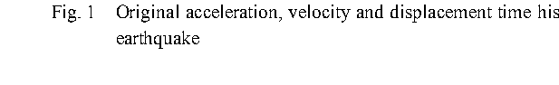
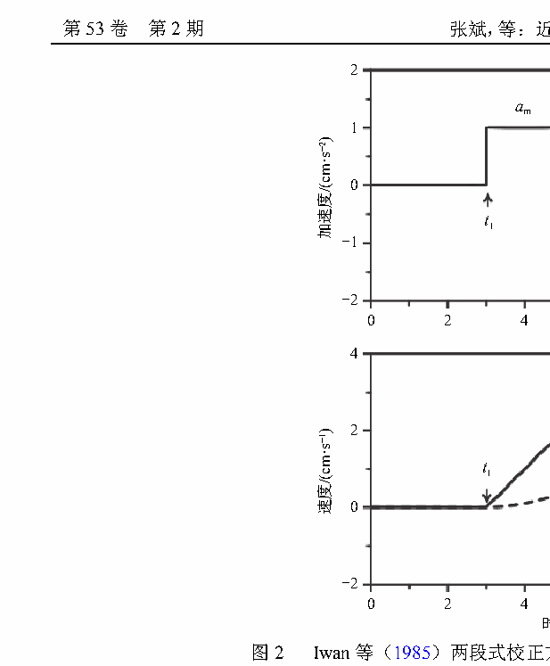

# 近场强震动记录基线校正方法（张斌、俞言祥，2022）— 逐节精读

> 说明：本文为中文综述，故采用"原文摘录 + 逐节解读"模式。原文引用用于定位证据，解读用于梳理分类体系与阅读要点。

## 文献信息

| 项目 | 内容 |
|---|---|
| 标题 | 近场强震动记录基线校正方法 |
| 作者 | 张斌、俞言祥（通信作者） |
| 单位 | 中国地质科学院地质力学研究所；自然资源部活动构造与地质安全重点实验室；中国地震局地球物理研究所 |
| 期刊 | 地球与行星物理论评，2022，53(2)：204–213 |
| DOI | 10.19975/j.dqyxx.2021-053 |
| 本地文件 | `参考文献/近场强震动记录基线校正方法.pdf` |
| 阅读状态 | 全文覆盖；结论与开放问题已整理 |

## 阅读导航

- 摘要与引言 — p.1–2（S001–S003）
- 第 1 节 基线偏移的原因 — p.3–4（S004–S006，E001–E002）
- 第 2 节 基线校正方法 — p.4–8（S007–S016，E003–E010，F001–F002）
  - 2.1 校正准则；2.2 高通滤波；2.3 Iwan 系单段/多段方法；2.4 小波方法
- 第 3 节 结论与展望 — p.8–9（S017–S019）

## 公式索引

- [E001 · 式 (2)](#E001) — p.4，水平摆倾斜引起的基线偏移
- [E002 · 式 (3)](#E002) — p.4，垂直摆倾斜引起的基线偏移
- [E003 · 式 (4)](#E003) — p.5，速度末尾段直线拟合
- [E004 · 式 (5)](#E004) — p.5，强震段漂移量确定
- [E005 · 式 (6)](#E005) — p.6，Boore 的 $v_0$ 校正
- [E006 · 式 (7)](#E006) — p.6，位移平坦度指标
- [E007 · 式 (9)](#E007) — p.7，位移时程向后推移
- [E008 · 式 (10)](#E008) — p.7，位移时程直线拟合
- [E009 · 式 (11)](#E009) — p.7，时移斜率比
- [E010 · 式 (12)](#E010) — p.7，均方根偏差

## 术语表

| 规范术语 | 英文 | 说明 |
|---|---|---|
| 基线偏移 | baseline drift/offset | 全文统一使用"基线偏移" |
| 低频误差 | low-frequency error | 仪器噪声、恒定偏移、背景噪声、初始值、操作误差 |
| 倾斜或旋转 | tilt or rotation | 地面变形导致仪器倾斜，水平摆敏感、垂直摆不敏感 |
| 强震段 | strong shaking phase | 起点 $t_1$、终点 $t_2$ |
| 结束段 | post-seismic phase | $t_2$ 之后至记录结束 |
| 高通滤波 | high-pass filter | 处理低频误差的标准手段，但会滤掉永久位移 |
| 非因果滤波 | acausal filter | 正反向各滤一次，零相移 |
| 零填充 | zero padding | 非因果滤波前的首尾补充，需余弦渐变过渡 |
| 平坦度 | flatness | Wu 和 Wu 提出的判别指标 $f$ |

## 正文

### 摘要与引言（p.1–2）

**Source:** p.1 S001

**原文:** 强震动加速度记录特别是近场强震动记录中经常会出现基线偏移的现象，加速度记录中的微小基线偏移会导致积分获得速度和位移时程产生不合理的非物理特征。本文详细地分析了低频误差和地面的倾斜或旋转对原始加速度记录积分获得的速度和位移时程的具体影响，讨论了近场强震动记录基线校正的准则。

**解读:** 摘要开篇即给出两个并列的漂移来源——低频误差与地面倾斜/旋转。这个"二分法"是全文的骨架，也是把单轴方法扩展到三分量时最重要的物理依据（倾斜对水平与垂直分量的影响量级相差极大）。

**Source:** p.1 S002

**原文:** 在没有可用的方法可以量化不同误差来源的贡献以及无法同时测量六个分量的强震动记录（三个平移分量和三个旋转分量）之前，利用大数据分析和机器学习等技术手段，基于 Iwan 方法原理，从海量的近场强震动记录中自动快速识别出稳定、可靠的强震段和结束段开始时间将是未来的发展方向。

**解读:** 摘要最后点出领域的两大空白：误差来源无法定量分解、六分量（三平移 + 三旋转）观测仍缺失，因而多数方法仍是经验或半经验。这两条既是你选题的"研究缺口"，也是任何新方法都必须承认的适用边界。

**Source:** p.2 S003

**原文:** 近场强震动记录由于基线偏移的影响，如果不进行任何处理直接积分成位移时程，位移时程末尾部分可能与零基线有很大偏差，甚至超过地震动位移本身，无法获得可靠的地震动峰值速度（PGV）、峰值位移（PGD）、永久位移信息和长周期加速度反应谱值，限制了地震动长周期成分的可用性。

**解读:** 这段列出了基线校正的四个直接产出指标：PGV、PGD、永久位移与长周期反应谱。后文讨论三轴扩展时，你的评价指标体系也应覆盖这四类。

### 第 1 节 基线偏移的原因（p.3–4）

**Source:** p.3 S004

**原文:** Chiu（1997）认为数字强震动记录中的低频误差是造成基线偏移的主要原因，根据低频误差的来源，将其分为仪器噪声、恒定偏移、背景噪声、初始值和操作误差等。仪器噪声的 5 个典型来源包括不完善的仪器响应、分辨率不足、采样率不足、电子噪声和基线偏移。……背景噪声和电子噪声的存在还会导致地震波到达前的加速度、速度和位移初始值非零，这些初始值可能导致位移波形出现较大的最终偏移。

**解读:** 低频误差的清单化梳理很重要：它说明"漂移"往往不是单一来源，而是多来源叠加。对三分量而言，三个通道的电子噪声与初始值彼此独立，但倾斜引起的那部分却可能在水平两轴间相关。

**Source:** p.4 S005

**原文:** 当地震发生时，近场区地表发生破裂、水平位移、隆起等强烈变形，导致强震仪产生一定的倾斜。……对于小的小倾斜它正比于 [1−cos(θ)]，cos(θ)≈1−θ²/2。……假设倾斜角为 0.06°，根据式（2）相当于基线偏移 1 cm/s2，若从 30 s 开始倾斜到 90 s 记录结束，水平向位移时程产生的最终基线偏移可达 18 m，垂直向位移时程产生的最终基线偏移只有 0.9 mm（王国权和周锡元，2004）。

**解读:** 全文最重要的量级对比：0.06° 的倾斜在水平向等效 1 cm/s²（1 gal）的基线偏移，并能在 60 s 内累积出 18 m 的位移误差；而垂直向只有 0.9 mm。**这就是"三轴 ≠ 三次单轴"的物理根源**：水平两轴共享受倾斜驱动的漂移，垂直轴几乎不受影响。

**Source:** p.4 E001 · 式 (2)

$$
\Delta g = g\theta
$$

**中文说明：** 该式为水平摆在小倾斜角下由倾斜引起的等效基线偏移，$\Delta g$ 为等效加速度偏移，$g$ 为重力加速度，$\theta$ 为倾斜角。正比于 $\theta$（一阶敏感）。

**Source:** p.4 E002 · 式 (3)

$$
\Delta g = \frac{g\theta^2}{2}
$$

**中文说明：** 该式为垂直摆对倾斜的响应，正比于 $\theta^2/2$（二阶敏感）。因此同样的倾斜角下，垂直分量的基线偏移比水平分量小几个数量级。

**Source:** p.4 S006

**原文:** 造成近场强震动记录基线偏移原因的复杂性导致了近场强震动记录的基线偏移类型也更为复杂，如单段线性偏移、两段式偏移、曲线式偏移、脉冲型偏移、初始偏移和多段式偏移等复杂偏移（彭小波，2011）。因此，为了更好地应用近场强震动记录的长周期成分，必须对数据进行基线校正处理。

**解读:** 这里给出了漂移形态的完整清单（比 L1 论文使用的三类模型更全）。如果你的三轴扩展要处理真实数据，应当用这份清单作为测试集的覆盖目标，而不是只测单/两/多段。

### 第 2 节 基线校正方法（p.4–8）

**Source:** p.4 S007

**原文:** 在地震引起的地面震动结束时，速度随时间趋于零，速度的这种特征是对任何地震动记录的合理约束……位移随时间趋于稳定值（零或永久位移值）。……因此，基线校正的结果需满足以下两点：（1）地震动停止后，地震动的速度趋于零；（2）位移时程的末尾段重合于或平行于零轴。

**中文:** 这两条准则是全领域的验收标准，也是 L1 方法第三条假设的来源。注意第（2）条的措辞"重合于或平行于零轴"，允许永久位移存在——三轴处理垂直分量时尤其不能误读为"位移必须回到零"。

**解读:** 三轴扩展时，建议把这两条准则逐分量写成约束检查表：每条时程尾部速度是否归零、位移末尾是否平行于时间轴；同时额外检查合成水平位移矢量的方向是否与 GPS 一致。

**Source:** p.5 S008

**原文:** 高通滤波方法是减少强震动加速度记录中长周期噪声应用最广泛的工具，也是 PEER-NGA 强震动数据库数据处理的标准程序。……滤波根本的选择是在因果滤波和非因果滤波之间进行选择，非因果滤波……不会在信号中产生任何相位失真，而因果滤波会导致记录中的相位变化。

**解读:** 高通滤波的关键词是"零相移"：要做到零相移就必须非因果（正反向各滤一次），而这需要零填充来提供缓冲。理解这一机制，才能理解后文为什么反复强调零填充与过渡带处理。

**Source:** p.5 S009

**原文:** 利用高通滤波处理强震动加速度记录时，最重要的问题是选择高通截止频率。Boore（2005）提出了三个同时应用的标准来选择高通截止频率：（1）记录的傅里叶谱（FAS）与噪声模型的 FAS 的比值大于或等于 3……（2）判断记录 FAS 的长周期部分偏离与 f2 成正比的衰减趋势；（3）目视检查滤波后加速度时程的一次、二次积分获得的速度和位移时程，并判断这些速度和位移时程是否呈现非物理特征。

**解读:** 三条截止频率选取标准是"可操作的客观化程序"，可直接用于你的预处理流程；其中第（3）条实际上回到了基线校正的判据，说明滤波与基线校正在评价标准上是一致的。

**Source:** p.5–6 S010

**原文:** 高通滤波可以很好地消除强震动加速度记录中的长周期误差，但是大震近场的加速度记录的长周期信息和永久位移信息也会在高通滤波的过程中被滤掉，因此高通滤波方法不适用于校正大震近场的强震动记录。

**解读:** 这是方法选择的判据：小震记录用高通滤波最省事、最不主观；大震近场要恢复永久位移则必须用分段校正。你的三轴方法应明确自己瞄准的是"大震近场永久位移"这一场景。

**Source:** p.5 S011

**原文:** Iwan 等（1985）表明基线偏移是由当加速度超过 50 cm/s2 时 PDR-1/FBA-13 型数字强震仪系统机械或电路的微小磁滞效应引起的，基线偏移在强震段期间（t1～t2）可能以复杂的方式发生变化，强震段后的结束段（t2～tend）基线偏移可能与强震段的基线偏移不同……Iwan 等（1985）提出从原始加速度记录相应时间段去掉两个基线偏移：t1 和 t2 之间的 am、t2 和 tend 之间的 af。

**解读:** 这段说明 Iwan 方法的物理出发点是仪器磁滞效应，而非地倾斜。理解这点很重要：Iwan 模型的"两段"是仪器物理机制，而倾斜引起的漂移可能是连续变化的，因此后续方法才要不断放宽分段结构（这正是 L1 稀疏方法的用武之地）。

**Source:** p.5 E003 · 式 (4)

$$
v_f(t) = v_0 + a_f t
$$

**中文说明：** 该式用直线拟合速度时程的末尾段；直线斜率 $a_f$ 即为结束段的加速度基线偏移量，$v_0$ 为截距。

**Source:** p.5 E004 · 式 (5)

$$
a_m = \frac{v_f(t_2)}{t_2 - t_1}
$$

**中文说明：** 该式由"校正后强震段末速度等于拟合直线在 $t_2$ 处的值"确定强震段的漂移量 $a_m$。

**Source:** p.6 E005 · 式 (6)

$$
t_2 = -\frac{v_0}{a_f}
$$

**中文说明：** Boore 的 $v_0$ 校正：把拟合直线与时间轴的交点作为基线开始偏移的时刻。该式说明 $v_0$ 校正本质上是让校正后位移不再漂移。

**Source:** p.6 E006 · 式 (7)

$$
f = \frac{|r|}{|b|\sigma}
$$

**中文说明：** Wu 和 Wu 的位移"平坦度"指标：$r$ 为线性相关系数，$b$ 为校正后位移末尾段拟合直线的斜率，$\sigma$ 为位移方差。平坦度越大，说明校正后位移尾部越平坦。

**Source:** p.7 E007 · 式 (9)

$$
t_1 = t_{end} - i\Delta
$$

**中文说明：** 以固定步长 $\Delta$ 从记录末尾向前搜索漂移起始时刻的候选点。

**Source:** p.7 E008 · 式 (10)

$$
d_i = d_{0,i} + a_{f,i}t
$$

**中文说明：** 张斌等（2020）用直线拟合位移时程的 $t_1 \sim t_{end}$ 段，$d_{0,i}$ 为截距，$a_{f,i}$ 为该段斜率。

**Source:** p.7 E009 · 式 (11)

$$
k_i = \frac{a_{f,i+1}}{a_{f,i}}
$$

**中文说明：** "时移斜率比"$k_i$：相邻拟合段斜率之比。当该比值趋于稳定时，认为找到了漂移起始时刻 $t_1$。

**Source:** p.7 E010 · 式 (12)

$$
\mathrm{RMSD} = \sqrt{\frac{1}{N}\sum_{n=1}^{N}\left[X_n(t)\right]^2}
$$

**中文说明：** 均方根偏差，用于判断二次函数/三次函数拟合位移末段的误差，从而选择更优的拟合阶数。

**Source:** p.6–7 S012

**原文:** 方法的关键是 t1 和 t2 时间点的选择。Iwan 等（1985）选择加速度的绝对值首次超过 50 cm/s2 的时间为 t1……Boore（1999，2001）、王国权和周锡元（2004）、Graizer（2005）认为还必须考虑地面倾斜的影响。……Boore（2001）在处理集集地震近场强震动记录时建议将 t1 作为一个自由参数……选择 t2 作为拟合速度的直线变为零的时间。

**解读:** 这一串演化（Iwan → Boore $v_0$ → 王国权 → Wu → Akkar → Chao → Wang → Lin → 熊政辉 L1）就是"如何减少 $t_1$、$t_2$ 选取主观性"的技术主线。读综述时把这条线单独画出来，你的文献综述部分就有了骨架。

**Source:** p.7 S013

**原文:** Chao 等（2010）简化了选取 t1 和 t2 的迭代过程，根据式（8）计算出加速度记录的能量分布比，利用加速度记录中能量分布的两个临界比值 25% 和 65% 来选择 t1 和 t2，自动确定基线校正的时间点，避免了人工选择带来的主观性。然而，该能量分布比是基于 2003 年成功 MW6.8 地震有限数量记录的经验值，而不是来自不同地震的大量记录，可能并不适用于其他地震。

**解读:** 这段展示了"自动化"与"泛化性"之间的张力：用经验比值自动定时刻很省事，但经验值来自特定数据集，换地震就未必成立。L1 方法避免了这个陷阱，因为它不依赖固定的能量比阈值。

**Source:** p.7 S014

**原文:** 熊政辉等（2019）运用加入 L1 范数正则化的最优化思想，以拟合速度误差尽可能小为目标并以加速度基线偏移稀疏为约束条件，通过凸优化技术多次迭代求解，可以自动识别出加速度记录中的单段式、两段式和多段式基线偏移。……赵思程等（2019）验证了典型的 Iwan 两段式校正方法、BAP 方法和基于 L1 范数优化的基线校正方法……结果表明基于 L1 范数优化的基线校正方法能更好地识别不同地震记录中基线偏移的起始时间以及偏移程度，减小了主观随机性。

**解读:** 综述对 L1 方法的定位与评价，正好印证了你阅读文献的连贯性：它被归入"基于 Iwan 原理发展出的半自动/自动校正方法"这一类，并且被视觉观测独立验证过（对应 2020 年 SDEE 论文）。

**Source:** p.7 S015

**原文:** Tian 等（2019）基于非倾斜二维振动台测试的观察结果，开发了一种具有累积校正模式的基线校正程序，并引入倾斜校正模式扩展了基线校正程序以处理 3-D 强震动，倾斜校正模式用于消除由于永久地面倾斜引起的积分速度的线性偏移。累积校正模式用于消除由于系统误差以及倾斜校正模式未捕获的倾斜引起的累积速度偏移。

**解读:** 这是综述中与你目标最接近的一条线索：Tian 等已经用"倾斜校正 + 累积校正"双模式处理三维强震动。建议把 Tian et al. (2019) 列为必读，比较"物理模式校正"与"L1 稀疏自动分段"两条路线的差异与互补性。

### 图 1 芦山地震 51YAM 台 NS 向原始加速度、速度与位移

**Placed near:** p.2 S003
**Source:** p.3 C001

**Original caption:** Fig. 1. Original acceleration, velocity and displacement time histories in the NS direction of 51YAM station from the Ms7.0 Lushan earthquake.

**中文图注:** 图 1 芦山 $M_S7.0$ 地震 51YAM 台站 NS 向原始加速度、速度和位移时程。

**Reading note:** 该图的位移时程呈明显抛物线状——这是"未校正记录的位移不可用"的直观教材；可作为你写研究背景时的配图依据。

**Source:** p.7–8 S016

**原文:** Chanerley 和 Alexander（2010）提出了一种新颖的基于小波的算法，旨在校正基线偏移和倾斜并整合到位移中……表明一旦时程经过小波变换和去噪，垂直分量的长周期部分根据 Graizer（2005）中方程（1）的条件积分为几乎完美的永久位移。考虑到各自的信号噪声比（Chanerley et al., 2009），由于倾斜的影响，水平分量虽然也成功校正，但是显示出明显的位移偏差。

**解读:** 小波方法的案例再次印证了水平/垂直的差异：垂直分量能恢复得"几乎完美"，水平分量因倾斜影响仍有明显偏差。这为三轴差异化处理提供了旁证。

### 图 2 Iwan 两段式校正方法原理图

**Placed near:** p.5 S011
**Source:** p.6 C002

**Original caption:** Fig. 2. Schematic diagram of Iwan et al. (1985) two-stage baseline correction method (modified from Wu and Wu, 2007).

**中文图注:** 图 2 Iwan 等（1985）两段式校正方法原理图（修改自 Wu and Wu, 2007）。

**Reading note:** 该图是理解全部 Iwan 系方法的钥匙：加速度域是两个常值段 $a_m$、$a_f$，速度域是折线，位移域是抛物线段。对照 $t_1$、$t_2$ 与式 (4)—(5) 一起看。

### 第 3 节 结论与展望（p.8–9）

**Source:** p.8 S017

**原文:** （1）低频误差和地面倾斜或旋转导致的基线偏移普遍存在于近场强震动记录中，在数据使用前对原始加速度记录进行高通滤波或基线校正非常必要……对于大震近场的强震动记录，需要从加速度记录中获取对高层或超高层建筑、大跨桥梁、管道等工程的抗震设计非常重要的可靠长周期地震动信息和永久位移信息，需采用单段式或多段式基线校正方法进行处理。对于小震的近场强震动记录，采用了高通滤波方法进行处理是最有效和最不主观的。

**解读:** 方法选择的原则被表述得非常明确：按震级/用途分流——大震近场用分段校正，小震用高通滤波。你的三轴方法应把适用范围写清楚。

**Source:** p.8 S018

**原文:** （2）目前常用的滤波器中，Butterworth 滤波器的稳定性最好；非因果滤波在滤波过程中不会造成信号产生任何相位失真；进行非因果滤波前在加速度记录首尾添加相同长度的零填充可以避免加速度积分得到的位移时程中出现偏移和尾部翘起的情况；使用的余弦渐变函数可以平滑零填充部分和记录的过渡带……严格的截止频率选取标准可以将高通截止频率选取的主观性降至最低。

**解读:** 这是一套可直接照做的工程参数清单：Butterworth + 非因果 + 等长零填充 + 余弦渐变 + Boore 三条截止频率标准。

**Source:** p.8 S019

**原文:** 然而，目前还没有方法可以量化不同误差来源的贡献，以及还不能测量强震动记录的三个旋转分量，已有这些基线校正方法大多针对特定的一个或几个地震的强震动记录的经验方法，并没有适用于大部分地震近场强震动记录的通用基线校正方法。随着全球范围内近场强震动数据的累积、目前大数据分析和机器学习等技术手段的日趋成熟，利用大数据分析和机器学习等技术手段，基于 Iwan 方法原理，从海量的近场强震动记录中自动快速地识别出稳定、可靠的校正时间点 t1 和 t2 将是未来发展方向。

**解读:** 综述给出的"未来方向"是数据驱动地自动确定 $t_1$、$t_2$。与 L1 方法的路线相比，一个用机器学习直接预测时间点，一个用凸优化自动求解漂移结构——两条路线可以互为验证，这也是你选题时可以借力的叙事。

## 阅读提示（critical reading notes）

1. 全文最有价值的量化结论是那组倾斜对比：0.06° 倾斜 → 水平向 1 gal 等效偏移 → 水平位移误差 18 m，而垂直向仅 0.9 mm。三轴扩展的物理动机就建立在这一组数字上。
2. 综述明确承认：现有方法大多针对特定地震的经验方法，缺少通用性；且缺少三旋转分量观测。这两点既是领域空白，也提示你"三平移分量的联合处理"本身就是合理的下一小步。
3. 建议把 2.3 节的方法演化（Iwan → Boore → Wu → Akkar → Chao → Wang → Lin → 熊政辉 L1 → Tian 3D → 张斌 2020）整理成时间轴，作为你论文引言部分的文献综述骨架。
