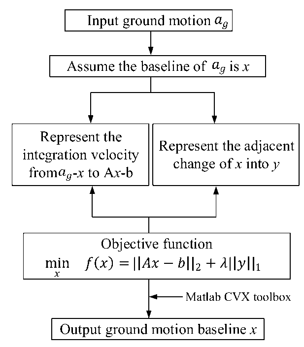
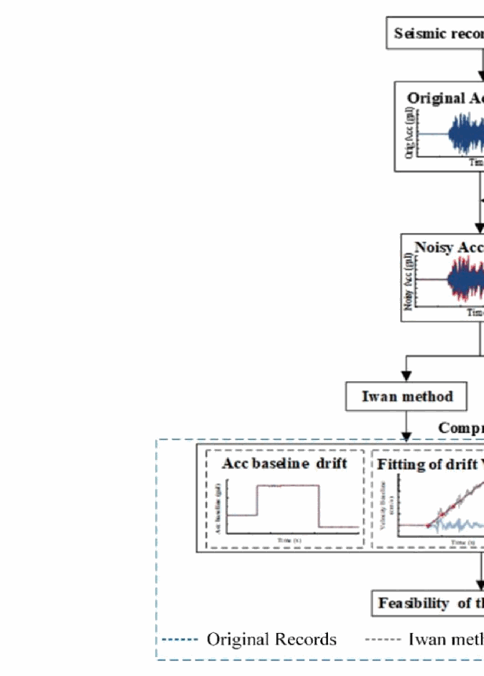
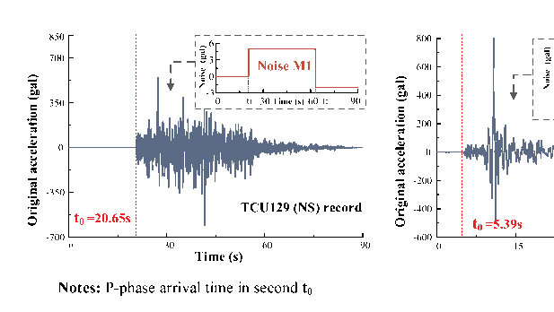
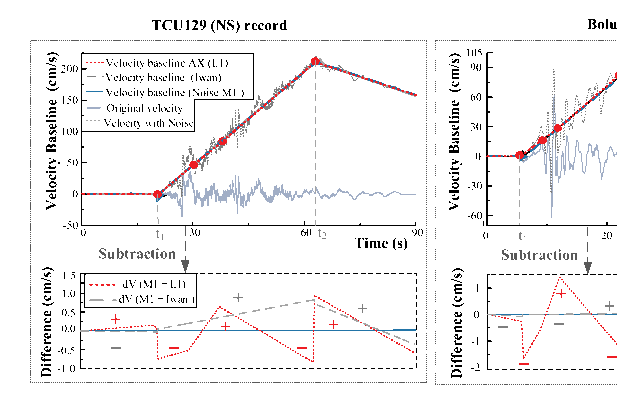
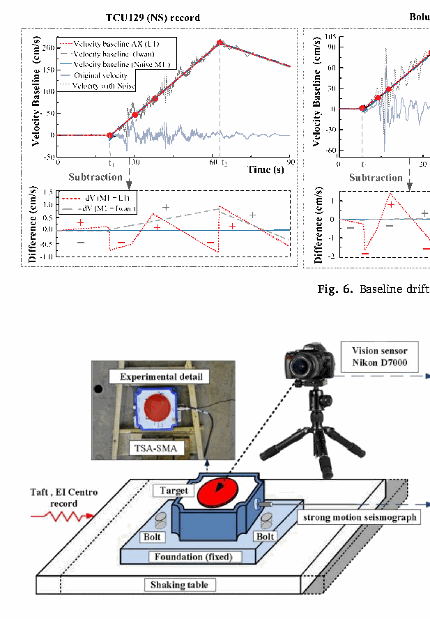
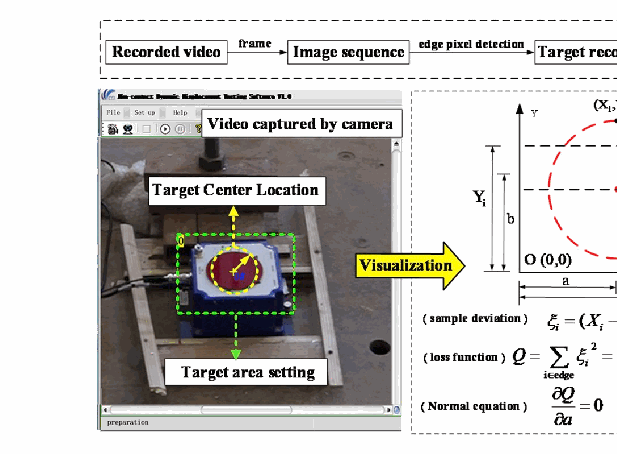
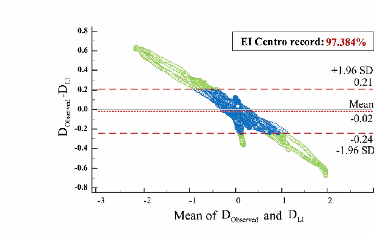
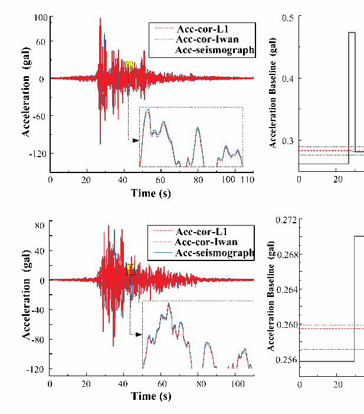

# Baseline correction based on L1-Norm optimization and its verification by a computer vision method — 中英对照精读

## 文献信息

| 项目 | 内容 |
|---|---|
| 标题 | Baseline correction based on L1-Norm optimization and its verification by a computer vision method |
| 作者 | Zhijun Dai, Xiaojun Li, Su Chen, Sicheng Zhao, Zhenghui Xiong |
| 单位 | Institute of Geophysics, China Earthquake Administration；Beijing University of Technology |
| 期刊 | Soil Dynamics and Earthquake Engineering, 131 (2020) 106047 |
| DOI | 10.1016/j.soildyn.2020.106047 |
| 篇幅 | 10 页（正文第 1—9 页，第 9—10 页为参考文献） |
| 本地文件 | `参考文献/Baseline-correction-based-on-L1-Norm-optimization-_2020_Soil-Dynamics-and-Ea.pdf` |
| 阅读状态 | 全文精读（Introduction → Section 5）；参考文献列表未逐条翻译，见 `translation_notes.md` |

## 阅读导航

- 第 1 节 引言 — p.1–2（S001–S008）
- 第 2 节 基于 L1 范数优化的基线校正 — p.2–3（S009–S015，E001–E002）
- 第 3 节 L1 方法的特性（与 Iwan 方法对比） — p.3–6（S016–S023，F001–F006）
- 第 4 节 基于视觉技术的验证 — p.6–8（S024–S027，F007–F011）
- 第 5 节 讨论与结论 — p.8–9（S028–S031）

## 公式索引

- [E001 · Eq. (1)](#E001) — p.2，基线跳跃量 $y_i$ 的定义
- [E002 · Eq. (2)](#E002) — p.2，L1 范数正则化目标函数

## 术语表

| 规范术语 | 中文 | 说明 |
|---|---|---|
| baseline drift / baseline offset | 基线漂移 / 基线偏移 | 全文核心对象；跳变（jump）对应基线的一次突变 |
| prior part / pre-event part | 事前部分 | 指 P 波到时之前的记录段；论文亦用 prior part |
| piecewise linear fitting | 分段线性拟合 | 在速度时程上分段拟合直线以反推加速度基线 |
| step function | 阶梯函数 | 基线在时间上分段恒定 |
| Iwan method | Iwan 方法 | 两段式基线校正的经典方法，以 50 gal 阈值确定 $t_1$、$t_2$ |
| Boore's $v_0$ method | Boore 的 $v_0$ 方法 | 以速度末尾拟合直线与时间轴交点确定基线起始时刻 |
| L1-norm regularization / LASSO | L1 范数正则化（LASSO） | 以稀疏性自动选择漂移段数与位置 |
| gal | 伽 | $1\ \mathrm{gal}=1\ \mathrm{cm/s^2}$ |
| Bland-Altman (B-A) diagram | Bland-Altman 一致性分析图 | 用于评价两组位移曲线的一致性 |
| adjacent part / prior part | 事前部分 / 邻前段 | 用于考察记录丢头对结果的影响 |

## 正文

### 1 Introduction（引言，p.1–2）

**Source:** p.1 S001

**Original:** Strong ground motion simulation and observation is an important research issue in earthquake engineering. The acquisition of a large number of valuable strong motion records can provide reliable basic data for the study of focal mechanisms, ground motion prediction equations (GPMEs), site and active fault effects on ground motion, soil-structure interactions, and seismic response characteristics of typical structures [1–3]. Baseline drift often exists in strong-motion acceleration records [4–7].

**中文:** 强地面运动的模拟与观测是地震工程的重要研究课题。大量有价值的强震记录的获取，可为震源机制、地震动预测方程（GPMEs）、场地与活动断层对地震动的影响、土–结构相互作用以及典型结构的地震反应特性等研究提供可靠的基础资料 [1–3]。强震动加速度记录中普遍存在基线漂移 [4–7]。

**Source:** p.1 S002

**Original:** [8] pointed out that small acceleration drift would result in huge numerical errors in the velocity and displacement obtained by integration. For example, when the acceleration drift of 0.01 gal is held for 60 s, the integral velocity will have an error of 0.6 cm/s, but the final displacement (also called permanent displacement or residual displacement in some references) will reach an error of 18 cm. Velocity and displacement time history play important roles in the in-depth study of ground motion near faults and seismic design in mega-seismic areas [9].

**中文:** 文献 [8] 指出，微小的加速度漂移会使积分得到的速度与位移产生巨大的数值误差。例如，0.01 gal 的加速度漂移持续 60 s 时，积分速度将产生 0.6 cm/s 的误差，而最终位移（亦称永久位移或残余位移）误差可达 18 cm。速度与位移时程对近断层地震动和极震区抗震设计的深入研究具有重要作用 [9]。

**Source:** p.1 S003

**Original:** Baseline correction plays a vital role for the obtaining the final displacement. The final displacement is useful to quantify the ground displacements of near faults. In the non-linear aseismic analysis of large structures, especially crossing faults, the time history of displacements significantly influences the responses of structures. Therefore, accurate baseline correction could ensure the reliability of non-linear numerical simulation.

**中文:** 基线校正对获取最终位移至关重要。最终位移可用于量化近断层的地面位移。在大型结构（尤其是跨断层结构）的非线性抗震分析中，位移时程显著影响结构反应。因此，准确的基线校正可保证非线性数值模拟的可靠性。

**Source:** p.1–2 S004

**Original:** In the analog recorder stage, the baseline judgment is complex and inaccurate due to factors such as the lack of prior parts, temperature change of the acquisition system amplifier, and unstable characteristics of low-frequency performance outside the frequency range of the sensor. Researchers generally consider it difficult to estimate displacements from acceleration records obtained using analog recorders [10–14]. The digital strong-motion seismograph developed in the 1970s has high precision, wide band, and pre-storage characteristics [15], and effectively overcomes the weaknesses of analog recorders.

**中文:** 在模拟记录仪阶段，由于缺少事前部分、采集系统放大器温度变化以及传感器频带外低频性能不稳定等因素，基线判断既复杂又不准确。研究者普遍认为难以从模拟记录仪获得的加速度记录估算位移 [10–14]。20 世纪 70 年代发展起来的数字强震仪具有高精度、宽频带和预存储特性 [15]，有效克服了模拟记录仪的缺点。

**Source:** p.1–2 S005

**Original:** Since then, researchers have studied the digital strong-motion records of a series of major earthquakes, such as the Parkfield Earthquake, Chi-Chi Earthquake, and Wenchuan Earthquake [4,5,16–22]. Displacements obtained by integrating the acceleration records of digital strong-motion seismographs are believed to contain long-term information. Permanent ground displacement caused by near-fault large earthquakes can be obtained by integrating high-quality acceleration records under certain conditions. However, the baseline drift of acceleration has a great influence on the final displacement [6].

**中文:** 此后，研究者对帕克菲尔德地震、集集地震、汶川地震等一系列大地震的数字强震记录开展了研究 [4,5,16–22]。人们认为，数字强震仪加速度记录积分得到的位移包含长周期信息；在一定条件下，近断层大地震引起的地面永久位移可以由高质量加速度记录积分获得。然而，加速度基线漂移对最终位移有很大影响 [6]。

**Source:** p.1–2 S006

**Original:** [6] pointed out that filtering should be avoided for strong motion records, and baseline correction used for processing to prevent the loss or distortion of permanent displacement information for objectively determining the permanent displacement of ground motion. However, because of the complexity of baseline drift in acceleration time history, it is difficult to intuitively determine the initial and final positions of the baseline drift and the magnitude of drift from acceleration records. Therefore, in majority of the instances, history of velocity is chosen as the entry point for analysis to identify the permanent displacement. [1,21]; and [23] systematically classified these methods.

**中文:** 文献 [6] 指出，为避免永久位移信息损失或畸变，应避免对强震记录直接滤波，而应采用基线校正，以便客观确定地面永久位移。但由于加速度时程中基线漂移的复杂性，很难从加速度记录直观确定漂移的起止位置与漂移量。因此，多数情况下选择速度时程作为分析切入点来识别永久位移。[1,21] 以及 [23] 对这些方法做了系统分类。

**Source:** p.2 S007

**Original:** In the current commonly used baseline correction methods, it is generally assumed that acceleration drifts over a given period of time. Moreover, the number of baseline sharp changes (or jumps) is also given based on prior subjective experience. Generally, the velocity time history is obtained by integrating the original records. Based on the drift of velocity time history, the baseline drift of acceleration time history is obtained by piecewise linear fitting of velocity. However, how to determine the number of segments and the locations of segments, that is, when the acceleration baseline has breaks, often requires expert judgment and selection. This selection leads to subjectivity in this kind of baseline correction procedure, and the automation and standardization of the entire procedure is not feasible [6].

**中文:** 在目前常用的基线校正方法中，一般假设加速度在某给定时间段内发生漂移，而且基线突变（跳变）次数也依据先验主观经验给定。通常先对原始记录积分得到速度时程，再依据速度时程的漂移情况，通过分段线性拟合速度来获得加速度时程的基线漂移。然而，如何确定分段数量与分段位置（即加速度基线在何时发生突变），往往需要专家判断与选择。这种选择使该类基线校正过程带有主观性，整个流程难以自动化与标准化 [6]。

**Source:** p.2 S008

**Original:** A polynomial formula was used to correct the baseline to determine the final displacement [16], which is one of the earliest influential developments in this field. To date, the most widely used method for baseline correction is that of [4]; which laid a foundation for the characteristics of baseline drifts. When an earthquake occurs, seismic waves propagate to stations at different distances and with different site conditions. The baseline drift of the acceleration records collected by a strong-motion seismograph is usually random.

**中文:** 文献 [16] 采用多项式公式校正基线以确定最终位移，是该领域最早且最具影响力的进展之一。迄今为止应用最广的基线校正方法是文献 [4]（Iwan 等）提出的方法，它为认识基线漂移特征奠定了基础。地震发生时，地震波传播到距离和场地条件各异的台站，强震仪采集到的加速度记录中的基线漂移通常是随机的。

**Source:** p.2 S009

**Original:** Taking the selection of the initial time of baseline drift as an example, two ways are commonly used. The first is that the baseline drift is mainly affected by the instrument response of the strong-motion seismograph. It occurs at the initial moment when the acceleration is greater than 50 gal. The second is that the baseline drift is mainly affected by the initial ground motion. It occurs at the initial time of P-wave arrival. The factors leading to acceleration drift are various and random.

**中文:** 以基线漂移起始时刻的选取为例，常用两种做法：其一是认为基线漂移主要受强震仪仪器响应影响，发生在加速度首次大于 50 gal 的时刻；其二是认为基线漂移主要受地面初始运动影响，发生在 P 波到达时刻。导致加速度漂移的因素多样且随机。

**Source:** p.2 S010

**Original:** They include not only the low frequency error (including instrument noise, background noise, initial value, etc.), but also the instrument tilt caused by ground torsion and tilting. It is difficult to clearly determine the exact moment at which acceleration drift occurs. Whether it is the time when the acceleration amplitude recorded by the strong-motion seismograph reaches a pre-determined threshold or the time when the ground initial motion occurs at the location of the strong-motion seismograph, it is an empirical judgment based on existing knowledge of strong motion data.

**中文:** 这些因素既包括低频误差（仪器噪声、背景噪声、初始值等），也包括地面扭转与倾斜引起的仪器倾斜。要明确判断加速度漂移发生的准确时刻十分困难。无论是取强震仪记录加速度幅值达到预定阈值的时刻，还是取台站处地面初始运动的时刻，都是基于已有强震动数据认识的经验判断。

**Source:** p.2 S011

**Original:** [5,18]; and [6] made baseline correction for a large number of strong motion records from the Chi-Chi Earthquake and Wenchuan Earthquake. They found that subjective intervention to choose the starting and ending points of baseline drift segments had great influence on the displacement results after baseline correction. Several improvements have been proposed to better determine the critical points for baseline drift [5,19,20,24,25]. Moreover, there have been other kinds of attempts for correction of the baseline [26] using a scheme based on empirical mode decomposition (EMD).

**中文:** 文献 [5,18] 与 [6] 对集集地震和汶川地震的大量强震记录进行了基线校正，发现人为干预选择基线漂移分段的起止点，会对校正后的位移结果产生很大影响。为更好地确定基线漂移的关键时刻，已有若干改进方法被提出 [5,19,20,24,25]。此外，还有基于经验模态分解（EMD）的基线校正尝试 [26]。

**Source:** p.2 S012

**Original:** In the work of [27,28]; the consistency of initial conditions has been analyzed systematically and proposed a target based detrending algorithm for baseline correction. Also with known final displacement from GPS, the displacement could be used as a constraint for baseline correction, and [29] presented a method that the pseudo-static component of ground motion records could be modified to satisfy the target displacement requirement.

**中文:** 文献 [27,28] 系统分析了初始条件的一致性问题，并提出了基于目标值的去趋势基线校正算法。在已知 GPS 最终位移的情况下，位移还可作为基线校正的约束；文献 [29] 提出可修改地震动记录的拟静力分量，使其满足目标位移要求。

**Source:** p.2 S013

**Original:** Recently, Whitney (2018) proposed to combine both the band-pass filtering method and adjustment based on the velocity trend [30]. presented a semiautomatic scheme for baseline correction; this method is used especially for recovering tectonic fling from near-source ground-motion recordings. In this scheme, a variety of factors for near-source baseline drifts are carefully considered. For the correction points, their combination should not generate spurious spikes on the acceleration time series. The flatness of the displacement after a time is also considered [31]. introduced a baseline correction method based on the correction patterns, in which the pattern is significantly different on recordings of non-tilt 2D shaking table tests and 3D strong ground motion recordings.

**中文:** 最近，Whitney（2018）提出将带通滤波与基于速度趋势的调整相结合 [30]，给出一种半自动基线校正方案，特别适用于从近源记录中恢复构造性 fling；该方案仔细考虑了近源基线漂移的多种因素，要求校正点的组合不能在加速度时程上产生虚假尖峰，并考虑某一时刻之后位移的平坦度。[31] 提出了基于校正模式的基线校正方法，指出该模式在无倾斜的二维振动台试验记录与三维强震动记录上存在显著差异。

**Source:** p.2 S014

**Original:** Our preliminary results for baseline correction based on L1 optimization were published in a Chinese journal [32]. The objective was to minimize the sum of variance of piecewise linear fitting velocity history and the absolute value of baseline drift. Instead of manually selecting the starting and ending points of baseline drift in advance, we tried to find a more widely applicable baseline correction method. The accuracy of baseline drift identification in baseline correction processing were verified by adding acceleration baseline drift noise artificially.

**中文:** 我们基于 L1 优化的基线校正初步成果已发表在一份中文期刊上 [32]。其目标是最小化分段线性拟合速度时程的方差与基线漂移绝对值之和。我们没有预先人为选择基线漂移的起止点，而是试图找到适用性更广的基线校正方法，并通过人工加入加速度基线漂移噪声来验证漂移识别的准确性。

**Source:** p.2 S015

**Original:** Although a variety of methods for baseline correction have been proposed, there is no method that works perfectly because of the difficulty and uncertainty in determining the origin of the drift [30,33,34]. Baseline correction is still an open and challenging problem. Here, we analyze the assumptions and properties of the L1-based method in depth. To illustrate the properties of this method, a full comparison with the method of Iwan is presented in Section 3. In Section 4, our vision-based verification approach is introduced. Then, a thorough comparison of methods of baseline correction follows. Some discussions are presented in Section 5.

**中文:** 尽管已提出多种基线校正方法，但由于难以确定漂移的成因且不确定性大，尚无一种方法尽善尽美 [30,33,34]。基线校正仍是一个开放且具挑战性的问题。本文深入分析 L1 类方法的假设与性质：第 3 节给出其与 Iwan 方法的全面对比，第 4 节介绍基于视觉的验证方法，随后给出基线校正方法的深入比较，第 5 节进行讨论。

### 2 Baseline correction based on L1-norm optimization（基于 L1 范数优化的基线校正，p.2–3）

**Source:** p.2 S016

**Original:** During an earthquake, baseline drift is a common phenomenon for ground motion recording instruments. There are numerous factors that cause the drift. One of the main reasons is the inclination of the plane ground for the instruments. The occurrence of inclination is thought to be a sparse phenomenon during earthquakes. Under this assumption, we formulated the baseline correction based on L1-optimization.

**中文:** 地震过程中，基线漂移是地震动记录仪器的常见现象，其成因众多，其中一个主要原因是仪器所在平面的倾斜。研究认为，地震期间的倾斜是一种稀疏现象。在该假设下，本文建立了基于 L1 优化的基线校正模型。

**Source:** p.2 S017

**Original:** The norm is a measure of the length or size of each vector in a vector space (or matrix). The L1 norm is the sum of the absolute values of all elements in a vector. It can effectively realize sparsity and prevent data over-fitting. It is also advantageous for feature selection. Invalid information in the data is removed through continuous iterative optimization. That is to say, the corresponding weight of these features is set to zero. However, the structure of the model is relatively simple and "interpretable". The L1 norm is widely used because of its good behavior during optimization (which can solve NP-hard problems).

**中文:** 范数是衡量向量空间（或矩阵）中向量长度或大小的量。L1 范数是向量中各元素绝对值之和，可有效实现稀疏性、防止过拟合，也有利于特征选择：通过不断迭代优化剔除数据中的无效信息，即将这些特征对应的权重置零。同时其模型结构相对简单、"可解释"。L1 范数因良好的优化性质（可求解 NP-hard 问题）而被广泛应用。

**Source:** p.2 S018

**Original:** Considering that the baseline drift is affected by several factors, we make the following assumptions: a) the drift of acceleration baseline is random and the drift times cannot be determined beforehand; b) the baseline drift at one time will remain unchanged, then change at another time, and continue to remain unchanged for a period of time; that is, the acceleration drift is a piecewise linear function of time (step function); c) after the earthquake ground motion, the velocity should be zero.

**中文:** 考虑到基线漂移受多种因素影响，本文作如下假设：a）加速度基线的漂移是随机的，漂移次数无法事先确定；b）某一时刻的基线漂移保持不变，直到另一时刻发生突变，随后又在一段时间内保持不变，即加速度漂移是时间的分段线性函数（阶梯函数）；c）地震动结束后，速度应趋于零。

**Source:** p.2 S019

**Original:** Based on these assumptions, and the commonly used method of least-squares piecewise linear fitting of the velocity history to find the baseline drift of acceleration, combined with the sparsity of the L1 norm, this paper proposes to use the L1 norm regularization method to solve the optimal baseline drift, aiming to minimize the variance of fitting drift velocity time history, and to constrain and minimize the baseline drift. Given the acceleration records $a_g$ with a time length $T$, sampling rate $\Delta T$, and the number of recorded points $n=T/\Delta T$, and assuming the baseline for $a_g$ is $x$, first, we denote the change of the baseline in the form of vector $y$,

**中文:** 在上述假设基础上，结合"对速度时程做最小二乘分段线性拟合以反推加速度基线漂移"的常用思路与 L1 范数的稀疏性，本文提出用 L1 范数正则化方法求解最优基线漂移：以拟合漂移速度时程的方差最小为目标，同时约束并最小化基线漂移本身。设加速度记录为 $a_g$，时长 $T$、采样率 $\Delta T$、记录点数 $n=T/\Delta T$，并设 $a_g$ 的基线为 $x$；首先以向量 $y$ 表示基线的变化量，

**Source:** p.2 E001 · Eq. (1)

$$
y_i = x_{i+1} - x_i
$$

**中文说明：** 该式定义基线 $x$ 的一阶差分 $y$，其长度为 $n-1$；$y$ 的稀疏性即意味着基线只在少数时刻发生跳变。

**Source:** p.2 S020

**Original:** Here, the vector $y$ has a dimension of $n-1$. Then, under our assumption, $y$ should be sparse. The velocity after baseline correction from acceleration is an integration to $a_g-x$, which has a linear relation with $x$, and we represent it in the form $Ax-b$. If there is no drift in the velocity time series, then the L2 norm of the velocity vector $\|Ax-b\|_2$ should not be large. For both targets, the baseline problem is formulated to the optimization problem of the following form

**中文:** 向量 $y$ 的维数为 $n-1$。按上述假设，$y$ 应当是稀疏的。对 $a_g-x$ 积分即得到基线校正后的速度，它与 $x$ 成线性关系，记为 $Ax-b$ 的形式。如果速度时程中不存在漂移，则速度向量的 L2 范数 $\|Ax-b\|_2$ 不应很大。兼顾两个目标，基线问题被转化为如下优化问题

**Source:** p.2 E002 · Eq. (2)

$$
\min_x f(x) = \|Ax-b\|_2 + \lambda\|y\|_1
$$

**中文说明：** 该式为本文的核心优化目标：第一项度量速度拟合残差（L2 范数），第二项对基线的差分 $y$ 施加 L1 正则化以获得稀疏跳变；$\lambda$ 为平衡两项的正则化参数。注意正则化作用在差分 $y$ 而非基线 $x$ 本身，这正是解表现为分段恒定阶梯基线的原因。

**Source:** p.3 S021

**Original:** In the formula $A\in\mathbb{R}^{m\times n}$, it is a complete dictionary (sparse representation), $b\in\mathbb{R}^m$, and $\lambda$ ($\lambda>0$) is a regularized parameter and the optimal solution (sparse solution) for fitting. L1 norm regularization is a two-criterion formula (that is, to ensure that the fitting residual $Ax-b$ is small while the vector $x$ is as small as possible). The residual is measured by the Euclidean norm ($\|Ax-b\|_2$), whereas the regularization is carried out by the L1 norm ($\|y\|_1$) [35].

**中文:** 式中 $A\in\mathbb{R}^{m\times n}$ 为完备字典（稀疏表示），$b\in\mathbb{R}^m$，$\lambda$（$\lambda>0$）为正则化参数，求解目标是使拟合达到最优的稀疏解。L1 范数正则化是一种双准则形式：既保证拟合残差 $Ax-b$ 较小，又使向量尽量小。残差用欧氏范数（$\|Ax-b\|_2$）度量，正则化用 L1 范数（$\|y\|_1$）实施 [35]。

**Source:** p.3 S022

**Original:** L1 norm regularization can be used as a heuristic algorithm to obtain sparse solutions, which can solve the following optimization problems. A process flow-diagram of the L1-optimization baseline algorithm can be seen in Fig. 1. Formula (O) is another equivalent form of LASSO (Least Absolute Shrinkage and Selection Operator) [35,36], and can also be regarded as a least-square fitting optimization method with constraints (the L1 norm regularization term). This is a typical convex optimization form. According to the analysis of convex optimization theory, it has one and only one global optimal solution.

**中文:** L1 范数正则化可作为求取稀疏解的启发式算法来求解该优化问题，其流程见图 1。该式是 LASSO（最小绝对值收敛与选择算子）的另一种等价形式 [35,36]，也可视为带约束（L1 正则项）的最小二乘拟合方法。这是典型的凸优化形式；由凸优化理论可知，它存在且仅存在一个全局最优解。

### Fig. 1. L1 优化基线算法流程图

**Placed near:** p.3 S022
**Source:** p.3 C001

**Original caption:** Fig. 1. Flow-diagram of the L1-optimization baseline algorithm.

**中文图注:** 图 1. L1 优化基线算法的流程图。

**Reading note:** 该图为近似紧裁（脚本按图注位置自动裁剪）。若边框不完整，请对照同页整页渲染 `assets/pages/p03.png`。重点看"输入加速度→构造差分字典→凸优化求解→输出基线漂移"的闭环。

**Source:** p.3 S023

**Original:** There are many methods to solve such problems, which can be roughly divided into four categories: first, classical iterative optimization algorithms, such as steepest descent method, conjugate gradient method, iterative weighted least squares method and interior point method; second, the homotopy algorithm; third, the greedy algorithm; fourth, the iterative shrinkage algorithm, which has emerged in recent years. Relatively speaking, the interior point method is a very important and widely used optimization method.

**中文:** 此类问题的求解方法大致分为四类：一是经典迭代优化算法，如最速下降法、共轭梯度法、迭代加权最小二乘法和内点法；二是同伦算法；三是贪婪算法；四是近年出现的迭代收缩算法。相对而言，内点法是非常重要的、被广泛使用的优化方法。

**Source:** p.3 S024

**Original:** This paper uses the convex optimization toolkit of CVX in MATLAB to solve for $x$. According to the summary of [37] and the example given by Ref. [36]; the regularization parameter $\lambda$ is set to 1 in this paper, which plays an important role in balancing the weight between the fitting error term and the L1 norm regularization term and in solving the minimum value of the objective function. The method of solving baseline drift based on L1 norm regularization can not only effectively reduce the amount of optimization calculation and obtain more accurate velocity fitting line, but also control the number of baseline jumps and the magnitude of baseline drift.

**中文:** 本文使用 MATLAB 的凸优化工具箱 CVX 求解 $x$。依据文献 [37] 的总结与文献 [36] 的示例，本文将正则化参数取为 $\lambda = 1$；该参数在平衡拟合误差项与 L1 正则项权重、求解目标函数最小值方面起重要作用。基于 L1 范数正则化求解基线漂移，不仅能有效减少优化计算量、获得更准确的速度拟合线，还能控制基线跳变次数与漂移幅度。

### 3 Characteristics of the L1-norm baseline correction method（L1 方法的特性，p.3–6）

**Source:** p.3 S025

**Original:** This paper describes the characteristics of this method by comparing the L1 method with the classical Iwan method. Both the L1 norm regularization optimization and the traditional Iwan baseline correction method use the least-square method to perform piecewise linear fitting of the drift velocity curve, and the zero-line drift of the acceleration record is then obtained. The two most basic parameters of piecewise fitting are the number of piecewise segments and the position of piecewise points. The Iwan method considers that the zero-line drift of acceleration occurs when the first and last accelerations exceed 50 gal respectively.

**中文:** 本文通过与经典 Iwan 方法对比来说明 L1 方法的特性。L1 范数正则化优化与传统 Iwan 基线校正方法都用最小二乘法对漂移速度曲线做分段线性拟合，进而求得加速度记录的零线漂移。分段拟合的两个最基本参数是分段数量与分段点位置。Iwan 方法认为加速度零线漂移发生在其首次与末次超过 50 gal 之时。

**Source:** p.3 S026

**Original:** The L1 norm regularization optimization method proposed in this paper is based on the characteristics of velocity information to segment and fit to obtain the optimal solution. It does not preset the number of segments or the location of segment points of baseline drift. For this study, two baseline correction methods were compared; the flow of the procedure is shown in Fig. 2. Seismic records (including acceleration, velocity, and displacement information) were selected to process the original seismic acceleration records with artificial noise.

**中文:** 本文提出的 L1 范数正则化优化方法依据速度信息本身的特征进行分段与拟合以获得最优解，不预先设定基线漂移的分段数量与分段点位置。本研究对比两种基线校正方法，流程见图 2：先选取包含加速度、速度与位移信息的地震记录，再对原始加速度记录施加工人噪声。

### Fig. 2. 不同基线校正方法效果评价的对比试验流程

**Placed near:** p.3 S026
**Source:** p.4 C002

**Original caption:** Fig. 2. Flow charts of comparative test schemes for evaluating the correction effects of different baseline correction methods.

**中文图注:** 图 2. 评价不同基线校正方法校正效果的对比试验流程图。

**Reading note:** 关注流程中的四个环节：原始记录→加人工噪声→两种方法分别校正→与已知噪声/原始速度位移对比。这套"已知真值"设计是本文方法学上的关键。

**Source:** p.3 S027

**Original:** The Iwan method and L1 norm optimization method were used respectively to correct noisy acceleration records. The baseline drift function was obtained and compared with the known artificial noise to verify the accuracy and reliability of different methods for baseline drift characteristic identification; the velocity and displacement obtained after correction were compared with the velocity and displacement of the original seismic record, and the reconstructing effects of different baseline correction methods on velocity and displacement time history were tested.

**中文:** 分别用 Iwan 方法与 L1 范数优化方法校正含噪加速度记录，将得到的基线漂移函数与已知的人工噪声对比，以检验不同方法识别基线漂移特征的准确性与可靠性；再把校正后得到的速度、位移与原始地震记录的速度、位移对比，检验不同方法对速度与位移时程的重构效果。

**Source:** p.3 S028

**Original:** For this study, three typical seismic records from the strong earthquake database of the Pacific Earthquake Engineering Research Center (PEER) were selected. They were the NS component of the Chi-Chi Earthquake at TCU129 Station, the EW component of the Duzce Earthquake at Bolu Station, and the NS component of the Imperial Valley Earthquake at EI Centro Array #9 Station. The original seismic ground motion plus noise is shown in Fig. 3. According to the STA/LTA method [45,46], the prior part time of each seismic record before P-wave arrival was 20.65 s, 5.39 s, and 0.04 s respectively.

**中文:** 本研究从太平洋地震工程研究中心（PEER）强震数据库中选取三条典型记录：集集地震 TCU129 台 NS 分量、迪兹杰地震 Bolu 台 EW 分量、帝王谷地震 El Centro Array #9 台 NS 分量。原始地震动与加入噪声后的结果见图 3。按 STA/LTA 方法 [45,46]，三条记录在 P 波到达之前的事前部分时长分别为 20.65 s、5.39 s 和 0.04 s。

### Fig. 3. 地震记录的选取与基线漂移噪声

**Placed near:** p.3 S028
**Source:** p.4 C003

**Original caption:** Fig. 3. Selection of seismic records and baseline drift noise.

**中文图注:** 图 3. 地震记录的选取与基线漂移噪声。

**Reading note:** 三条记录事前部分差异极大（20.65 s / 5.39 s / 0.04 s），这是全文最重要的对照组设置。

**Source:** p.3–4 S029

**Original:** Considering the sparsity of L1 norm constraints and the theoretical assumption of the Iwan method [4,35,37], the baseline drift forms obtained by the two methods are piecewise linear functions. In experiments on the commonly used Iwan method and the L1-based baseline correction method, the Iwan method has a clear two-stage baseline correction feature with the baseline drift of the acceleration occurring when the first and last time of accelerations exceed 50 gal; and the baseline correction method based on L1 norm optimization benefits from the convex optimization and sparse characteristics of the algorithm itself, which can automatically fit the stepwise baseline in the iterative process, and the method is unaffected by the form of the noise function, which reduces subjective randomness.

**中文:** 考虑到 L1 范数约束的稀疏性与 Iwan 方法的理论假设 [4,35,37]，两种方法得到的基线漂移形式都是分段线性函数。在对比实验中，Iwan 方法具有明确的两段式特征，其漂移发生在加速度首次与末次超过 50 gal 之时；而基于 L1 范数优化的方法得益于凸优化与算法自身的稀疏特性，可在迭代过程中自动拟合阶梯状基线，且不受噪声函数形式影响，从而降低了主观随机性。

**Source:** p.4 S030

**Original:** To better reflect the advantages and disadvantages of these two different baseline correction methods, a two-stage noise model was used here as the input for baseline drift. Its amplitude was 5 gal in the $[t_1,t_2]$ period and $-2$ gal in the $[t_2,t_{end}]$ period, where $t_1$ and $t_2$ are the first and last time points for baseline jumps of the seismic records respectively. The specific values of $t_1$ and $t_2$ were chosen based on numerous drift observation and some drift recordings of ground motions, the drift time has a randomness in when the drift will occur; however, it usually occurs when the acceleration exceeds a large value. Therefore, we set the $t_1$ and $t_2$ randomly for the duration when the ground motion is strong.

**中文:** 为更好体现两种方法的优劣，这里采用两段式噪声模型作为基线漂移输入：在 $[t_1,t_2]$ 段幅值为 5 gal，在 $[t_2,t_{end}]$ 段为 $-2$ gal，其中 $t_1$、$t_2$ 分别为记录基线跳变的首次与末次时刻。$t_1$、$t_2$ 的具体取值依据大量漂移观测与部分地震动漂移记录确定；漂移发生的时刻具有随机性，但通常发生在加速度较大的时段。因此，本文在强震动持续时段内随机设定 $t_1$ 与 $t_2$。

**Source:** p.4 S031

**Original:** By analyzing the acceleration baseline drift contrast map (see Fig. 4), we can see that the two-stage noise model has the same solution as the model proposed by Iwan. Therefore, the acceleration baseline drift function processed by the Iwan method is in good agreement with the known noise model. The acceleration baseline drift function recorded by TCU129 (NS) using the L1 norm regularized baseline correction method is almost identical the result from the known noise model (with error less than 0.1 gal), and the differences between the positions of segment points and the preset model for the first and last drift times $t_1$ and $t_2$ are 0.1 s and 0.3 s respectively.

**中文:** 由加速度基线漂移对比图（图 4）可见，两段式噪声模型与 Iwan 模型解一致，因此 Iwan 方法处理得到的加速度基线漂移函数与已知噪声模型吻合良好。用 L1 范数正则化方法得到的 TCU129（NS）加速度基线漂移函数与已知噪声模型几乎完全一致（误差小于 0.1 gal），首次与末次漂移时刻 $t_1$、$t_2$ 的分段点位置与预设模型的差异分别为 0.1 s 和 0.3 s。

### Fig. 4. 加速度基线漂移对比图

**Placed near:** p.4 S031
**Source:** p.5 C004

**Original caption:** Fig. 4. Baseline drift contrast map of acceleration.

**中文图注:** 图 4. 加速度基线漂移对比图。

**Reading note:** 三类记录分别对应三行，对比"加入的已知噪声"与"两种方法识别的漂移"；TCU129 那一行几乎完全重合。

**Source:** p.4 S032

**Original:** For the Bolu (EW) records, the error of the recognition results is about 1.17 gal, and the differences of the first and last drift times $t_1$ and $t_2$ are 0.1 s and 0.3 s respectively. For the EI Centro (NS) records, the error of baseline drift is about 1.39 gal, and the differences of first and last drift times $t_1$ and $t_2$ are 0.53 s and 0.35 s respectively. The L1 norm regularized baseline correction method thus is more sensitive to the trend of baseline drift.

**中文:** 对 Bolu（EW）记录，识别结果的误差约为 1.17 gal，首次与末次漂移时刻 $t_1$、$t_2$ 的差异分别为 0.1 s 和 0.3 s；对 El Centro（NS）记录，基线漂移误差约为 1.39 gal，$t_1$、$t_2$ 的差异分别为 0.53 s 和 0.35 s。可见 L1 范数正则化基线校正方法对基线漂移的趋势更为敏感。

**Source:** p.5 S033

**Original:** The displacement obtained by the L1 norm regularization baseline correction method and Iwan method is shown in Fig. 5 (a). As the figure shows, the displacement time history obtained by the Iwan method has an obvious tail drift phenomenon. In contrast, the displacement time history curve corrected by the L1 norm method has high similarity to the displacement time history (twice integrations of the ground motion baseline correction disposed by PEER), which basically maintains the integrity of displacement information.

**中文:** 图 5(a) 给出 L1 正则化方法与 Iwan 方法得到的位移。可以看出，Iwan 方法得到的位移时程存在明显的尾部漂移现象；相比之下，L1 范数方法校正后的位移时程与参照位移时程（PEER 已做基线校正记录的二次积分）高度相似，基本保持了位移信息的完整性。

### Fig. 5. 不同方法校正位移曲线对比与 Bland-Altman 分析

**Placed near:** p.5 S033
**Source:** p.5 C005

**Original caption:** Fig. 5. (a). Comparison of displacement curves corrected by different methods; (b). B-A diagram of displacement curves corrected by the new method and contrast standard.

**中文图注:** 图 5. (a) 不同方法校正后位移曲线对比；(b) 新方法校正位移与对比标准位移的 B-A 一致性分析图。

**Reading note:** (b) 中 95% 一致性界限内散点占比是定量结论的来源；后文给出的相关系数 97.456%、96.825%、95.420% 分别对应 TCU129、Bolu、El Centro。

**Source:** p.5 S034

**Original:** The Bland-Altman method was used to analyze the random effect of displacement difference $D_{origin}-D_{L1}$ [47,48]. The correlation of $D_{origin}$ and $D_{L1}$ was 97.456%, 96.825%, and 95.420% respectively in each case. According to the results of seismic record correction (baseline drift identification and displacement reconstruction), the correlation of TCU129 (NS) displacement data processed by the L1 norm regularization baseline correction method is the highest, followed by Bolu (EW) and EI Centro (NS).

**中文:** 采用 Bland-Altman 方法分析位移差值 $D_{origin}-D_{L1}$ 的随机效应 [47,48]。三种记录下 $D_{origin}$ 与 $D_{L1}$ 的相关系数分别为 97.456%、96.825% 和 95.420%。从基线漂移识别与位移重构的结果看，L1 正则化方法处理的 TCU129（NS）位移数据相关性最高，Bolu（EW）次之，El Centro（NS）最低。

**Source:** p.6 S035

**Original:** This is due to the obvious difference in the prior part of the seismic record (see Fig. 2), in which the TCU129 (NS) record (20.65s), Bolu (EW) record (5.39s), and EI Centro (NS) record (0.04s) lose the former part. It can be found that the displacement is more accurate when the positive and negative area difference (integral error) of the velocity zero line is small. When the L1 norm baseline correction method is fitted, the prior part of the noisy record is "pulled closer" to the zero line several times to ensure that the physical meaning of the strong earthquake record is clear (before the earthquake starts, the baseline is zero). For the missing records of the prior part, the fitting velocity may have included the integral drift error of the prior part.

**中文:** 这源于三条记录事前部分差异明显：TCU129（NS）为 20.65 s、Bolu（EW）为 5.39 s，而 El Centro（NS）仅 0.04 s，即丢失了前段。可以发现，当速度零线的正负面积差（积分误差）较小时，位移更准确。用 L1 正则化方法拟合时，含噪记录的事前部分会被多次"拉近"零线，以保证强震记录的物理意义明确（地震开始前基线为零）。对缺失事前部分的记录，拟合速度可能已包含事前部分的积分漂移误差。

**Source:** p.6 S036

**Original:** Therefore, the longer the prior part of the seismic records is, the better the accuracy and stability of baseline drift identification by the L1 norm regularized baseline correction method is. Figs. 4 and 5 show that the acceleration baseline drift and permanent displacement information can be reconstructed effectively by using the L1 norm regularization optimization baseline correction method. The velocity baseline fitted by the two methods is compared with the reference velocity, and the results are shown in Fig. 6.

**中文:** 因此，地震记录的事前部分越长，L1 范数正则化基线校正方法识别基线漂移的精度与稳定性越好。图 4、图 5 表明，该方法能有效重构加速度基线漂移与永久位移信息。两种方法拟合的速度基线与参照速度的对比见图 6。

**Source:** p.6 S037

**Original:** In the process of regularization optimization, the correction method based on the L1 norm continuously fits the baseline for the time history of drift velocity and pulls it back to the vicinity of the zero line. Thus, the fitted velocity baseline presents an obvious multi-segment linear distribution. The number of segments in this method is determined according to the best fitting curve of velocity and time history. According to the difference graph of the velocity zero line, the velocity zero-line difference obtained by this method fluctuates near the mean zero line; however, the velocity zero-line difference obtained by the Iwan method cannot be adjusted according to the demand, and the error accumulates continuously in the integration process, which makes the displacement curve show a significant drift phenomenon.

**中文:** 在正则化优化过程中，基于 L1 范数的方法不断对漂移速度时程拟合基线并将其拉回零线附近，因此拟合出的速度基线呈现明显的多段线性分布，其分段数量由速度时程的最佳拟合曲线决定。从速度零线差值图看，该方法得到的零线差值在零均值附近波动；而 Iwan 方法得到的零线差值无法按需调整，误差在积分过程中不断累积，使位移曲线出现显著漂移。

### Fig. 6. 速度基线漂移对比图

**Placed near:** p.6 S037
**Source:** p.6 C006

**Original caption:** Fig. 6. Baseline drift contrast map of velocity.

**中文图注:** 图 6. 速度基线漂移对比图。

**Reading note:** 与图 4 对照阅读：加速度域是阶梯，速度域就是折线；"多段线性"正是稀疏跳变在速度域的体现。

### 4 Verification of the baseline correction method based on visual technology（基于视觉技术的验证，p.6–8）

**Source:** p.6 S038

**Original:** To further verify the effect of the baseline correction method on seismic records with complex background noise in a real environment, a verification platform for baseline correction methods based on computer vision was designed and built. The experimental design is shown in Fig. 7. The TSA-SMA accelerometer of EQMet Company was selected and bolted to a motion table to record the acceleration data during vibration. In our experiments, the EI Centro and Taft records, with the peak acceleration adjusted, were used as input ground motions. Visual displacement sensors were arranged outside the platform to measure the absolute displacement of the platform.

**中文:** 为进一步验证基线校正方法在真实环境下处理含复杂背景噪声记录的效果，本文设计并搭建了基于计算机视觉的基线校正验证平台，试验设计见图 7。选用 EQMet 公司的 TSA-SMA 加速度计，用螺栓固定在振动台上，记录振动过程中的加速度数据。试验以调幅后的 El Centro 波和 Taft 波作为输入地震动。在台面外布置视觉位移传感器，测量台面的绝对位移。

### Fig. 7. 基于视觉的基线校正方法验证

**Placed near:** p.6 S038
**Source:** p.6 C007

**Original caption:** Fig. 7. Verification of the baseline correction method based on vision.

**中文图注:** 图 7. 基于视觉的基线校正方法验证。

**Reading note:** 注意"加速度计—振动台—视觉位移传感器"三者的空间布置与数据对应关系。

**Source:** p.6 S039

**Original:** The baseline correction method based on L1 norm regularization was used to process the noisy acceleration. The corrected displacement time history curve of the method was compared with the visual observation value to verify the accuracy and applicability of the method. To ensure the accuracy of the visual test results, a Nikon D7100 high-definition camera with a resolution of 1,920 x 1,080 pixels was selected as the visual sensor; the frame rate reached 60 frames per second.

**中文:** 用 L1 范数正则化基线校正方法处理含噪加速度，并将该方法校正后的位移时程曲线与视觉观测值对比，以验证方法的准确性与适用性。为保证视觉测试结果的精度，选用分辨率为 1920×1080 像素的 Nikon D7100 高清相机作为视觉传感器，帧率达到 60 帧/秒。

**Source:** p.8 S040

**Original:** A contactless displacement measurement system based on C++ and Open CV software digitized the dynamic video of the target position recorded by the camera into space displacement coordinates by using a computer vision algorithm. This method realizes the dynamic capture and physical description of the object motion. The specific flow chart of the system is shown in Fig. 8. For a comparison of contactless line displacement measurement technology with a laser displacement meter and strain displacement meter, see Ref. [50]. To date, this technology has been successfully applied in structural deformation monitoring and strong motion observation [50–52].

**中文:** 一套基于 C++ 与 OpenCV 的非接触式位移测量系统，利用计算机视觉算法把相机记录的靶点动态视频数字化为空间位移坐标，实现对物体运动的动态捕捉与物理描述，系统流程见图 8。非接触式线位移测量技术与激光位移计、应变位移计的比较见文献 [50]。该技术目前已成功应用于结构变形监测与强震动观测 [50–52]。

### Fig. 8. 自主开发的非接触式位移测量系统

**Placed near:** p.8 S040
**Source:** p.7 C008

**Original caption:** Fig. 8. Independent developed non-contact displacement measurement system.

**中文图注:** 图 8. 自主研发的非接触式位移测量系统。

**Reading note:** 该系统是本文"验证"环节的核心工具，后续要用它的输出当作位移真值。

**Source:** p.8 S041

**Original:** Baseline correction of acceleration collected by a strong-motion seismograph using the Iwan method and L1 norm regularization method is shown in Fig. 9. The integral displacement time history curve processed by the Iwan method has obvious drift and abrupt change in the low frequency band of the displacement spectrum. The integral displacement curve processed by the L1 norm regularization method is in good agreement with the visual observations in the time domain and frequency domain, and the waveforms of the displacement time history curves of the two methods have the same trend.

**中文:** 图 9 给出用 Iwan 方法与 L1 正则化方法对强震仪采集加速度的校正结果。Iwan 方法处理得到的积分位移时程存在明显漂移，且位移谱低频段出现突变；L1 正则化方法处理得到的积分位移曲线在时域与频域都与视觉观测吻合良好，两种方法得到的位移时程波形总体趋势一致。

### Fig. 9. 视觉观测与校正位移在时域、频域的对比

**Placed near:** p.8 S041
**Source:** p.7 C009

**Original caption:** Fig. 9. Displacement comparisons between observations and corrections in the time and frequency domains.

**中文图注:** 图 9. 观测值与校正值在时域与频域的位移对比。

**Reading note:** 频域对比尤其关键：低频段是否还有虚假能量，是判断基线是否残留漂移的直接证据。

**Source:** p.8 S042

**Original:** According to the B-A chart (see Fig. 8), the correlation between the two curves is 97.34% and 95.68% respectively, as shown in Fig. 10. In addition, the spectra of the two curves are almost the same, and the main peak frequencies are almost the same. It can be concluded that this method has a good effect on seismic records with complex background noise.

**中文:** 由 B-A 图（图 10）可见，两条曲线的相关系数分别为 97.34% 与 95.68%。此外，两条曲线的谱几乎一致，主峰频率也基本相同。由此可以认为，该方法对含复杂背景噪声的地震记录具有良好效果。

### Fig. 10. 新方法与视觉观测结果的 B-A 图

**Placed near:** p.8 S042
**Source:** p.7 C010

**Original caption:** Fig. 10. B-A diagram of the curve obtained by the new method and vision-observed results.

**中文图注:** 图 10. 新方法所得曲线与视觉观测结果的 B-A 图。

**Reading note:** 这里的 97.34%/95.68% 对应 El Centro 与 Taft 两组台面试验。

**Source:** p.8 S043

**Original:** The corrected time and frequency curves of seismic acceleration were compared and analyzed, as shown in Fig. 11. Compared with the Iwan method, the L1 norm regularization method uses a convex optimization tool to iteratively optimize the solution, and automatically calculates the velocity baseline with the least fitting error and the appropriate number of segments. As the baseline drift of acceleration is calculated indirectly by the velocity of piecewise linear fitting, this method is more sensitive to trend changes of baseline drift. It can effectively eliminate the baseline drift error caused by low-frequency signal and reconstruct seismic displacement. However, any baseline correction method can inevitably suppress seismic signals, such that the displacement amplitude obtained by the correction is smaller than the true value.

**中文:** 图 11 对校正后地震加速度的时域与频域曲线做了对比分析。与 Iwan 方法相比，L1 正则化方法利用凸优化工具迭代求解，自动计算拟合误差最小、分段数量合适的速度基线。由于加速度基线漂移是由分段线性拟合的速度间接求得的，该方法对基线漂移的趋势变化更敏感，可有效消除低频信号引起的基线漂移误差并重构地震位移。但是，任何基线校正方法都不可避免地会压制地震信号，使校正得到的位移幅值小于真值。

### Fig. 11. 加速度校正前后对比图

**Placed near:** p.8 S043
**Source:** p.8 C011

**Original caption:** Fig. 11. Contrast charts before and after acceleration correction.

**中文图注:** 图 11. 加速度校正前后的对比图。

**Reading note:** 该图提示：校正不仅是"消漂移"，也会改变信号本身，这是方法局限性的直观证据。

### 5 Discussion and conclusion（讨论与结论，p.8–9）

**Source:** p.8 S044

**Original:** In essence, the method proposed in this paper based on L1 norm regularization is an upgrade of Boore's $v_0$ method [5,15]; that is, the baseline drift position and magnitude of the acceleration record can be obtained by fitting the velocity history with a linear piecewise function. Its innovation lies in the use of the optimization idea of adding L1 norm regularization. Instead of fixing acceleration baseline drift as single, two or more segments manually, it avoids human intervention by making the fitting speed error as small as possible and the calculated acceleration baseline drift as small as possible, thus expanding the generality of the baseline correction method.

**中文:** 本质上，本文提出的基于 L1 范数正则化的方法是对 Boore $v_0$ 方法 [5,15] 的升级，即通过用分段线性函数拟合速度时程来获得加速度记录的基线漂移位置与幅度。其创新在于引入 L1 范数正则化的优化思想：不再人为地把加速度基线漂移固定为单段、两段或多段，而是通过使拟合速度误差尽可能小、所求加速度基线漂移尽可能小来避免人为干预，从而拓展了基线校正方法的通用性。

**Source:** p.8 S045

**Original:** (1) The longer the prior part of a seismic record is, the more advantageous it is to accurately identify the position and degree of baseline drift. The method in this paper can identify different types of baseline drift very well when dealing with acceleration records with a certain prior part. Generally, more standard seismic records will include about 20 s in advance. The more sufficient the prior part is, the more accurate the baseline drift results obtained by this method are. When the prior part of the seismic acceleration record is too short (obvious loss of head) and is not zero, the method in this paper will "pull" the acceleration to the zero line.

**中文:** （1）地震记录的事前部分越长，越有利于准确识别基线漂移的位置与程度。对具有一定事前部分的加速度记录，本文方法能很好地识别不同类型的基线漂移；通常较规范的记录约含 20 s 的事前部分。事前部分越充分，方法得到的基线漂移结果越准确。当事前部分过短（明显丢头）且不为零时，本文方法会把加速度"拉"向零线。

**Source:** p.8–9 S046

**Original:** (2) The method in this paper is applicable to single-segment, two-segment and multi-segment acceleration baseline drift. The type of baseline drift can be identified automatically without setting the number of baseline drift in advance. Moreover, the method in this paper can also detect the trend of velocity drift more acutely (slope change), and can effectively capture the change of velocity drift, which is easily ignored in expert judgment. Especially in the multi-segment baseline drift noise, the number of segments of velocity fitting will be increased, which will lead to increase of the number of baseline jumps.

**中文:** （2）本文方法适用于单段式、两段式与多段式加速度基线漂移，无需预先设定漂移次数即可自动识别漂移类型。此外，该方法能更敏锐地察觉速度漂移的趋势（斜率变化），有效捕捉专家判断中容易被忽略的速度漂移变化。特别是在多段式基线漂移噪声下，速度拟合的分段数量会增加，从而导致识别出的基线跳变次数增多。

**Source:** p.9 S047

**Original:** (3) The method in this paper can recover the velocity and displacement time history after baseline correction of acceleration. Whether or not there is enough acceleration record in the prior part, this method can restore the PGV value very well. It also has a good restoring effect for the whole velocity time history. The longer the prior part of the seismic record is, the better the displacement time history recovery effect of the method in this paper is; in contrast, there may be large deviations.

**中文:** （3）本文方法能够恢复基线校正后的速度与位移时程。无论加速度记录的事前部分是否充足，该方法都能很好地恢复 PGV，对整个速度时程也有良好的恢复效果。地震记录事前部分越长，本文方法对位移时程的恢复效果越好；反之则可能出现较大偏差。

**Source:** p.9 S048 · Data and resources

**Original:** The earthquake records were downloaded from Pacific Earthquake Engineering Research Center (https://ngawest2.berkeley.edu/), the L1-norm baseline correction program was compiled by Matlab software, Figs. 1–10 were produced by Microsoft Excel 2016 and Microsoft Visio 2016. The software used in the section 4.2 was compiled by C++ and Open CV software.

**中文:** 地震记录下载自太平洋地震工程研究中心（https://ngawest2.berkeley.edu/）；L1 范数基线校正程序用 MATLAB 编写；图 1—10 由 Microsoft Excel 2016 与 Microsoft Visio 2016 绘制；4.2 节所用软件由 C++ 与 OpenCV 编写。

## 阅读提示（critical reading notes）

1. 本文的相对中文版（2019）最大的信息增量有三处：其一，正则项明确作用在基线的**差分** $y$ 上，而非基线本身，因此解天然是"阶梯状"分段恒定基线；其二，与 Iwan 方法做了同一数据下的定量对比；其三，建立了视觉位移验证平台并把 Bland-Altman 一致性分析引入基线校正验证。
2. 结论中最值得警惕的一句话是"任何基线校正方法都会压制地震信号，使校正位移幅值小于真值"。这一点在任何新方法的评价里都应作为对照项。
3. 三条记录的对比本质上是"事前部分长度"的单因素实验：20.65 s / 5.39 s / 0.04 s。该方法的速度恢复对事前部分长度不敏感，位移恢复则高度敏感。
4. 论文未给出字典 $A$ 的元素级定义，$\lambda$ 固定为 1 也未做敏感性分析，这是后续复现与改进时必须自行补齐的两处空白。
