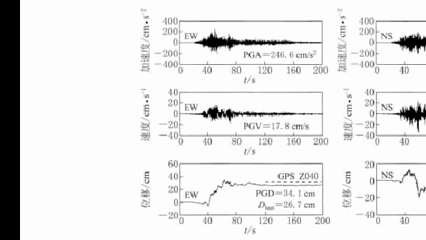
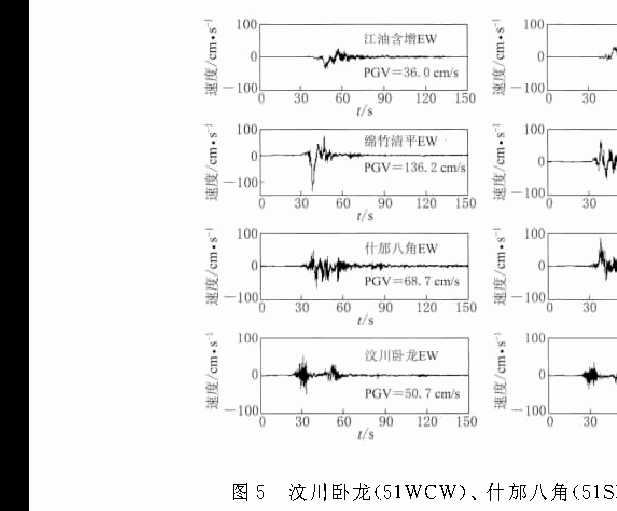
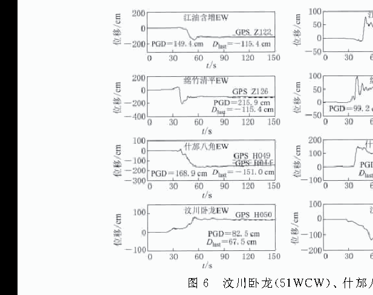

# 利用强震数据获取汶川地震近断层地面永久位移（谢俊举等，2013）— 逐节精读

> 说明：本文为中文文献，采用"原文摘录 + 逐节解读"模式。这篇论文的价值不在方法创新，而在于它展示了**三分量记录从校正到与 GPS 对比验证的完整工程流程**——正是三轴扩展最终要交付的产品形态。

## 文献信息

| 项目 | 内容 |
|---|---|
| 标题 | 利用强震数据获取汶川地震近断层地面永久位移 |
| 作者 | 谢俊举、温增平、高孟潭 |
| 单位 | 中国地震局地球物理研究所；北京工业大学 |
| 期刊 | 地震学报，2013，35(3)：369–379 |
| DOI | 10.3969/j.issn.0253-3782.2013.03.008 |
| 本地文件 | `参考文献/利用强震数据获取汶川地震近断层地面永久位移_谢俊举.pdf` |
| 阅读状态 | 全文覆盖（摘要、引言、数据、方法、比较、结论）；参考文献列表未展开 |

## 阅读导航

- 摘要 — p.1（S001）
- 引言：永久位移的意义与已有方法 — p.2–3（S002–S003）
- 第 1 节 强震记录与 GPS 数据 — p.3（S004–S005，F001）
- 第 2 节 基线校正方法与原则 — p.3–6（S006–S009，E001，F002–F006）
- 第 3 节 与 GPS 及地质考察结果的比较 — p.6–9（S010–S012，T001，F007–F008）
- 第 4 节 讨论与结论 — p.9–10（S013–S014）

## 公式索引

- [E001 · 式 (1)](#E001) — p.4，速度末尾段直线拟合

## 术语表

| 规范术语 | 英文 | 说明 |
|---|---|---|
| 永久位移 | permanent displacement | 校正后位移时程末尾的稳定值 |
| 同震位移 | co-seismic displacement | GPS 震前震后观测之差，含少量震后蠕变 |
| 三分量/三分向 | three-component | EW、NS、UD 三个方向 |
| 上盘/下盘 | hanging wall / footwall | 以映秀—北川断裂为界 |
| 断层距 | fault distance | 台站到地表破裂的最短距离 |
| $\upsilon_0$ 方法 | $v_0$ correction | 以速度末尾拟合直线与零线交点定漂移起始时刻 |

## 正文

### 摘要（p.1）

**Source:** p.1 S001

**原文:** 利用汶川地震中得到的靠近映秀—北川主断裂的 64 个强震台站的三分量记录数据，对加速度记录进行基线校正的基础上获取近断层地面运动的永久形变位移，并将由强震记录获取到的地面位移结果与 GPS 观测到的同震位移进行对比分析，研究汶川 Ms8.0 地震的近断层地面运动的位移特征。结果表明：① 在靠近映秀—北川主断层的上盘和下盘，东西相向的地面运动非常剧烈。下盘的 51SFB，51MZQ 和 51JYH 台东西向位移均为负（即地面运动向西），其中 51SFB 台位移量最大，达到 1.49 m；上盘的 51WCW 台位移向东，位移量为 1.26 m。② 地面运动的位移分布主要表现为以龙门山断裂带的映秀—北川断裂为核心的相向运动，东西方向上的永久位移要大于南北方向。……③ 大的地面永久位移集中分布在以龙门山断裂带为中心的狭长范围内，离开发震断裂地面位移的衰减很快。

**解读:** 摘要给出的是"成果型"结论（位移场特征），而不是方法学结论。对你的三轴工作而言，这篇论文的意义在于：它示范了如何把 64 个台站的**三分量**记录变成可发表的位移场结果，并用 GPS 逐台检验。

### 引言：永久位移的意义与已有方法（p.2–3）

**Source:** p.2–3 S002

**原文:** 对于宽频带数字强震仪，在仪器场址没有发生同震地面变形，且环境和仪器噪声很低的情况下，地震中的地面运动速度和位移时程可以由强震加速度数据直接积分得到。然而，在发生地面变形的情况下，可能导致强震仪的倾斜，引起加速度记录基线的偏移。加速度记录基线的微小偏移，对于加速度时程本身的影响很小，但通过积分求速度和位移时程时，基线偏移被逐步放大。

**解读:** 引言把"是否能直接积分"的条件说清楚了：场址无同震变形且噪声低时可以直接积分；一旦发生地面变形（近断层大震必然发生），倾斜引起的漂移就会通过两次积分被放大。这正是近断层场景必须做基线校正的原因。

**Source:** p.2–3 S003

**原文:** Iwan 等（1985）针对强震仪有关部件的磁滞效应问题提出一种对基线的偏移校正的方法。该方法认为由磁滞效应引起的基线偏移在加速度大于 50 cm/s2 时开始出现……此外还选取加速度值最后一次达到 50 cm/s2 或满足使得校正后的永久位移最小的时刻作为 t2……但这种分段的方法带有一定的主观性。Chiu（1997）采用一种高通滤波处理的方法……但由于该方法对加速度记录波形进行了滤波处理，校正后只能得到部分的地面永久位移。不同于 Iwan 等选择 t1 和 t2 的方法，Boore（2001）以及王国权和周锡元（2004）选取速度时程末尾的拟合直线与时间轴的交点时刻作为基线偏移的初始时刻，对加速度记录进行分段校正。

**解读:** 这篇 2013 年的论文采用的正是 Boore/王国权的 $\upsilon_0$ 路线（速度末尾拟合直线与零线交点）。把它与 2019 年的 L1 方法并读，你就能看到同一问题的两代解法：一个是"取一个交点"，一个是"稀疏优化自动定出全部跳变"。

### 第 1 节 强震记录与 GPS 数据（p.3）

**Source:** p.3 S004

**原文:** 在汶川地震中，中国强震动观测网络系统记录到 420 组震相完整的主震强震加速度记录。其中，龙门山断裂带及其周围地区有 50 多个强震动台站获得了大于 1 m/s2 的加速度记录，有 46 组三分向加速度记录的断层距小于 100 km……中国数字强震动观测台网所使用的仪器均为数字强震动仪，多数为美国 Kinemetrics 公司生产的 ETNA 型和瑞士 SYSCOM 公司生产的 MR2002 型。ETNA 型数字强震仪量程为 ±2g，分辨率为 18bit，采样率为 200 点/秒；MR2002 型数字强震仪量程为 ±2g，分辨率为 18bit，采样率为 200 和 500 点/秒。

**解读:** 数据规模与仪器参数说明这是"大样本"研究（420 组记录中筛出 64 台用于分析），其结论比单台案例更可信。注意采样率 200/500 Hz——如果你要用这份数据做三轴方法验证，采样率差异会影响积分与差分矩阵的构造。

**Source:** p.3 S005

**原文:** 本文选取靠近映秀—北川主断裂的 64 个强震台站的三分量记录和 41 个 GPS 观测台站的同震位移数据，研究此次 Ms8.0 地震近断层地面运动的位移形变特征。

**解读:** 64 个强震台 × 3 分量 = 192 条时程，与 41 个 GPS 点对比。这就是三轴方法的理想测试集形态：**多台站、多分量、有独立真值**。

### 图 1 发震断层附近强震观测台站和 GPS 观测站分布

**Placed near:** p.3 S005
**Source:** p.4 C001

**Original caption:** Fig. 1. Location of strong motion stations and GPS observation stations along the causative fault. Solid triangles and circles indicate the strong motion stations and GPS stations, respectively.

**中文图注:** 图 1 发震断层附近强震观测台站和 GPS 观测站分布。实心三角表示强震动台站，实心圆表示 GPS 观测台站。

**Reading note:** 该图决定"台站—GPS 配对"的几何关系：配对点距离越近，位移对比越可靠（文中给出 0.3、0.3、3.7 km 三个近距离配对的例子）。

### 第 2 节 基线校正方法与原则（p.3–6）

**Source:** p.3–4 S006

**原文:** 目前，强震记录的基线校正方法主要可以分为两类：一类是针对低频噪音和误差提出的滤波方法，主要有美国地质调查局（USGS）的加速度记录基础处理程序和 Chiu（1997）采用的高通滤波方法；另一类为 Iwan 等（1985）基于对速度时程进行直线拟合的思想提出的分段校正方法。滤波方法由于采用了滤波处理，校正后不能保留地面的永久位移信息，因而不适合对近断层的强震记录进行基线校正。

**解读:** 与 2022 年综述的分类一致（滤波 vs 分段）。这里给出了明确的取舍理由：本文目标是永久位移，所以必须用分段校正而不能用滤波。

**Source:** p.4 S007

**原文:** 本文基于对速度时程进行直线拟合的思想，选取强震记录的速度时程末尾段的拟合直线与时间轴的交点作为基线偏移的初始时刻，分段对强震记录进行基线校正。其基本思想是用一直线来拟合速度时程的末尾段。式（1）中 af 为速度时程基线偏移的斜率。求得拟合直线与时间轴零线的交点 tf 即为基线开始偏移的时刻，直线的斜率 af 即为相应加速度时程基线的偏移量，在基线开始偏移的相应加速度时程段中减去拟合直线的斜率 af，消除原始加速度记录中的基线偏移。

**解读:** 这是本文方法的全部内容（单段 $\upsilon_0$ 型），实现上非常简单。它与 L1 方法的差别只有一个：**这个交点是"一条直线"定出来的，还是用稀疏优化在整段速度上自动解出来的**。这也说明你只要把 L1 方法接到同样的三分量数据上，就可以与这篇论文的结果直接对比。

**Source:** p.4 E001 · 式 (1)

$$
v_f = v_0 + a_f t
$$

**中文说明：** 用该直线拟合速度时程末尾段：$a_f$ 为速度时程基线偏移的斜率（即加速度基线偏移量），$v_0$ 为截距；拟合直线与零线的交点即为基线开始偏移时刻 $t_f$。

**Source:** p.5 S008

**原文:** 判断基线校正结果的是否合理，主要有两条准则：① 地震动停止后，地面运动的速度是否为零，即记录的末尾速度值是否为零；② 在没有永久位移的情况下，记录末尾的位移值是否也为零。若台站所处位置发生了永久位移，则位移记录的末尾值即为所处地面在该方向上的永久位移。由于地面永久位移主要发生在强震阶段，所以在地震动的末尾阶段，地面位移值应该基本保持不变，即在位移时程上表现为地震动末尾的时程曲线应大致平行于时间轴。

**解读:** 两条准则与综述完全一致，但这里的措辞对三轴更有指导意义：**"没有永久位移时末尾位移为零；有永久位移时末尾值就是永久位移"**。应用到垂直分量时，若该点确有沉降（如 51SFB 的 UD 永久位移 −0.49 m），就应当保留，而不是拉回零。

### 图 2 基线校正方法图解

**Placed near:** p.4 S007
**Source:** p.5 C002

**Original caption:** Fig. 2. Graphical illustration of the baseline correction method used in this study.

**中文图注:** 图 2 基线校正方法图解。以 51MXD 台加速度初始化处理后的速度时程为例，直线拟合末尾段，交点给出漂移起始时刻 $t_2$，斜率 $a_f$ 给出漂移量。

**Reading note:** 与综述图 2（Iwan 两段式）对照：本篇只做"一条直线、一段校正"，是更简化的版本。

### 图 3 51PXZ 台校正后三分向加速度、速度和位移时程

**Placed near:** p.5 S009
**Source:** p.5 C003

**Original caption:** Fig. 3. Three component acceleration, velocity and displacement time histories obtained from 51PXZ record after baseline correction.

**中文图注:** 图 3 台站 51PXZ 记录校正后三分向的加速度、速度和位移时程。$D_{last}$ 为校正后获取到的永久位移，PGA/PGV/PGD 分别为峰值加速度、峰值速度、峰值位移。

**Reading note:** 这是你最终成果图的标准模板：每个分量三行（加速度/速度/位移），并在位移末尾标注 $D_{last}$。建议三轴方法完成后直接复用这一版式。

**Source:** p.5–6 S009

**原文:** 由 51PXZ 台记录获取到的永久位移分别为 −45.7，52.0 和 −11.1 cm；参考 GPS 台站 PIXI 的同震位移为 −56.3，42.6 和 −8.1 cm。参考 GPS 台站 PIXI 与强震台站 51PXZ 距离 0.3 km。51MXD 台记录获取到的永久位移分别为 26.7，−5.3 和 −3.6 cm；参考 GPS 台站 Z040 的同震位移为 31.0 和 −3.4 cm，该台没有垂直方向的位移资料。GPS 台站 Z040 与 51MXD 台站的距离仅 0.3 km。

**解读:** 两个最近距离配对（0.3 km）的对比结果：水平向误差约 10 cm 量级，垂直向误差约 3 cm。这组数字可作为你验证三轴方法时的精度基准线。

### 图 4 51MXD 台校正后三分向加速度、速度和位移时程

**Placed near:** p.6 S009
**Source:** p.6 C004

**Original caption:** Fig. 4. Three component acceleration, velocity and displacement time histories obtained from 51MXD record after baseline correction.

**中文图注:** 图 4 台站 51MXD 记录校正后三分向的加速度、速度和位移时程，$D_{last}$ 为校正后获取到的永久位移。

**Reading note:** 与图 3 同版式，可对比"上盘/下盘"台站的波形差异。

### 图 5 四个近断层台站校正后的三分向速度时程

**Placed near:** p.7 S010
**Source:** p.6 C005

**Original caption:** Fig. 5. Three component velocity time histories obtained from 51WCW, 51SFB, 51MZQ and 51JYH records after baseline correction.

**中文图注:** 图 5 汶川卧龙（51WCW）、什邡八角（51SFB）、绵竹清平（51MZQ）及江油含增（51JYH）台校正后的三分向速度时程，PGV 为地面运动峰值速度。

**Reading note:** 检查每条速度时程尾部是否归零——这是校正是否成功的直观判据。

### 图 6 四个近断层台站校正后的三分向位移时程

**Placed near:** p.7 S010
**Source:** p.7 C006

**Original caption:** Fig. 6. Three component displacement time histories obtained from 51WCW, 51SFB, 51MZQ and 51JYH records after baseline correction.

**中文图注:** 图 6 汶川卧龙、什邡八角、绵竹清平及江油含增台校正后的三分向位移时程（$D_{last}$ 为永久位移，PGD 为峰值位移）。

**Reading note:** 三轴的关键阅读点：末尾段是否平行于时间轴（准则 ②），以及垂直向末尾是否保留非零的永久沉降。

### 第 3 节 与 GPS 及地质考察结果的比较（p.6–9）

**Source:** p.7 S010

**原文:** 什邡八角台（51SFB）位于映秀—北川主断裂的下盘，距离断层 10.4 km……校正后获取到的东西、南北向地面永久位移分别为 −1.51 和 0.93 m；垂直位移为 −0.49 m，方向向下。由于 51SFB 台距离断层要比 GPS 参考台站近，其获取到的垂直位移比 GPS 台站 H044（0.12 m）和 H049（0.22 m）观测到的位移量大，而与该处断层附近地质考察得到的垂直位移量（0.5—0.6 m）是吻合的。

**解读:** 这是一个很典型的"GPS 不吻合但地质考察吻合"的案例，其原因是参考 GPS 台离断层更远、位移衰减更快。做三轴验证时，必须区分"方法误差"与"参考点空间不一致造成的误差"。

**Source:** p.7–8 S011

**原文:** 我们选取了 12 个强震台站获取到的地面位移与 GPS 观测结果进行对比分析（表 1），选择的标准是参考 GPS 观测台站至强震记录台站的距离在 30 km 以内。从表 1 可以看出，由强震记录获取到的地面永久位移结果（包括位移方向和大小）与 GPS 观测结果是一致的。此外，可以注意到强震台站 51WCW，51PZ X，51CDZ 和 51MXD 与相应的 GPS 参考台站 H050，PIXI，CHDU 和 Z040 的距离较近（分别为 3.7，0.3，6.9 和 0.3 km）。

**解读:** 表 1 是全文的验证核心：**12 台 × 3 分量 × 两套观测**。它同时暴露了验证的现实约束——只有 3—4 个台站的 GPS 距离够近，其余只能做量级与方向的一致性检查。你的三轴方法若要严谨验证，应优先挑近距离配对台站。

**Source:** p.8 T001

**原文:** 表 1 获取的 12 个台站的强震永久位移与 GPS 观测结果比较

| 强震台 | 断层距/km | 强震 EW/cm | 强震 NS/cm | 强震 UD/cm | GPS 台 | 台站距/km | GPS EW/cm | GPS NS/cm | GPS UD/cm |
|---|---|---|---|---|---|---|---|---|---|
| 51MZQ | 3.2 | −115.4 | 52.4 | −52.5 | Z126 | 14.7 | −122.1 | 37.9 | −20.4 |
| 51SFB | 10.4 | −149.0 | 92.3 | −48.0 | H049 | 20.5 | −127.6 | 80.1 | −21.6 |
| 51WCW | 23.2 | 67.5 | −38.2 | −30.1 | H050 | 3.7 | 64.0 | −37.4 | −22.8 |
| 51PXZ | 25.7 | −45.7 | 52.0 | −11.1 | PIXI | 0.3 | −56.3 | 42.6 | −8.1 |
| 51JYH | 13.6 | −115.4 | 36.2 | −10.5 | Z122 | 18.7 | −94.5 | 43.9 | 46.6 |
| 51AXT | 18.9 | −98.0 | 30.2 | −7.5 | H044 | 16.6 | −98.3 | 39.7 | −12.3 |
| 51MXD | 72.9 | 26.7 | −5.3 | −3.6 | Z040 | 0.3 | 31.0 | −3.4 | 无资料 |
| 51JYT | 23.9 | −104.0 | 28.5 | −34.2 | Z122 | 29.8 | −94.5 | 43.9 | 46.6 |
| 51DYB | 34.0 | −31.2 | 2.3 | 37.2 | H048 | 14.8 | −30.2 | 9.9 | −2.5 |
| 51PWM | 51.6 | 23.6 | 9.3 | −3.7 | H032 | 24.3 | 46.6 | 7.0 | 无资料 |
| 51DXY | 54.6 | −3.1 | 6.1 | −5.9 | 2049 | 12.2 | −11.8 | 12.0 | −5.7 |
| 51CDZ | 73.5 | −18.5 | 16.3 | −4.0 | CHDU | 6.9 | −15.8 | 11.7 | −1.1 |

**解读:** 该表可直接作为你论文中"验证表"的模板。阅读要点：近距配对（51PXZ–PIXI、51MXD–Z040、51WCW–H050）吻合最好；远距配对的差异同时包含方法误差、GPS 震后蠕变与空间衰减三重因素，不能简单归因于方法。

**Source:** p.7–8 S012

**原文:** 值得指出的是，在汶川地震中，仅有 51WCW，51MXD 和 51PXZ 三个台站的参考 GPS 台站距离在 4 km 以内。而对于其它台站而言，由于参考 GPS 台站距离强震台站较远，GPS 观测位移本身会与强震记录位移有较大差异，这时只能利用 GPS 位移作为参考来判断强震位移的大小范围和方向。此外，由于断层两侧地面缓慢的蠕变，根据震前与震后的 GPS 位移观测数据对比得到的同震位移中，包含有一定的震后地面蠕变位移……而数字强震仪记录到的永久位移只是在强震仪开始触发到记录结束这一段时间内发生的永久位移，因此 GPS 观测位移与由数字强震仪记录到的永久位移也会有一定的差别。

**解读:** 这段是全文最重要的"误差归因"说明。它告诉你三轴验证时应当如何措辞：近距离配对用于定量比较，远距离配对只用于量级与方向的一致性检查；同时 GPS 含震后蠕变、强震仪只覆盖触发时段，二者本就不可完全等同。

### 图 7 强震记录与 GPS 观测的水平永久位移对比

**Placed near:** p.8 S011
**Source:** p.9 C007

**Original caption:** Fig. 7. Comparison of obtained permanent horizontal displacement of Wenchuan earthquake from strong motion stations (a) with co-seismic displacement distribution observed by GPS stations (b).

**中文图注:** 图 7 由强震记录获取到的汶川地震水平向永久位移（a）与 GPS 观测到的同震位移（b）的比较。实心圆表示强震台站，空心圆表示 GPS 观测台站。

**Reading note:** 该图是"三分量结果 → 水平位移矢量场"的呈现方式：箭头方向 = 位移方向，箭头长度 = 位移量。三轴方法的价值最终也要体现在这类矢量场的合理性上。

### 图 8 东西向同震位移随断层距的分布

**Placed near:** p.8 S012
**Source:** p.10 C008

**Original caption:** Fig. 8. E-W co-seismic displacement of the Wenchuan Ms8.0 earthquake obtained from both strong motion and GPS data.

**中文图注:** 图 8 由强震记录和 GPS 观测数据获取的汶川 $M_S8.0$ 地震的东西向同震位移值（横轴为断层距，上盘取负、下盘取正）。

**Reading note:** 用剖面图检验"位移随断层距衰减"的整体规律，比单台对比更能说明方法的可靠性。

### 第 4 节 讨论与结论（p.9–10）

**Source:** p.9–10 S013

**原文:** 1）在靠近映秀—北川主断层 的上盘和下盘，东西相向的地面运动非常剧烈。下盘的 51SFB，51MZQ 和 51JYH 台东西向位移均为负，即地面运动向西。其中 51SFB 台东西向位移量最大，达到 1.49 m；上盘的 51WCW 台位移值为正，为向东方向的运动，位移量为 1.26 m。此外，紧靠发震断层的 51SFB，51MZQ，51JYH 和 51WCW 台的南北向的位移要比东西向小。

**解读:** 结论 1 描述位移场的相向运动特征。请注意位移量的符号约定必须与坐标方向严格一致——三轴扩展时，符号约定错误会让矢量场完全反号。

**Source:** p.10 S014

**原文:** 本研究表明，利用强震记录获取的地面位移信息与 GPS 观测数据联合研究大地震近断层地面位移特征是一个很好的途径。需要指出的是，在汶川地震中，仅有 51WCW，51MXD 和 51PXZ 三个台站的参考 GPS 台站距离在 4 km 以内。而对于其它台站而言，由于参考 GPS 台站距离强震台站较远，GPS 观测位移本身会与强震记录位移有较大差异，这时只能利用 GPS 位移作为参考来判断强震位移的大小范围和方向。

**解读:** 结论段落最后的自我限定，实际上给出了三轴验证的方法论：**以近距离 GPS 配对做定量验证，以全场分布做定性验证**。这条原则同样适用于你后续用 L1 三分量方法处理这批数据。

## 阅读提示（critical reading notes）

1. 这篇论文的方法很朴素（单段 $\upsilon_0$ 型），但它的价值在于**成品形态**：三分量记录 → 逐分量校正 → 永久位移 → GPS/地质考察对比 → 位移场特征。这正是你三轴 L1 方法最终要交付的东西。
2. 垂直分量必须区别对待：51SFB 的 UD 永久位移为 −0.49 m（向下沉降），是真实信号；若强行拉回零，就会破坏垂向位移场。
3. 验证的三种"不吻合"来源要分清：方法误差、参考 GPS 含震后蠕变、台站与 GPS 点空间不一致导致的位移衰减差异。
4. 可操作性最强的借鉴是表 1 与图 3/图 4 的版式：前者用于定量对比，后者用于展示三分量校正结果。
