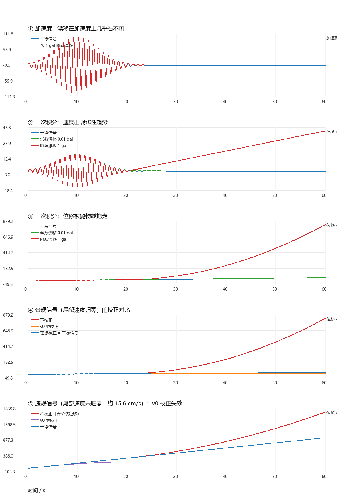
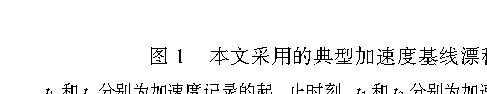
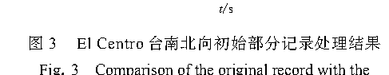
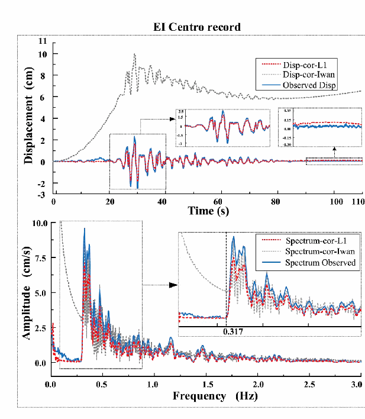
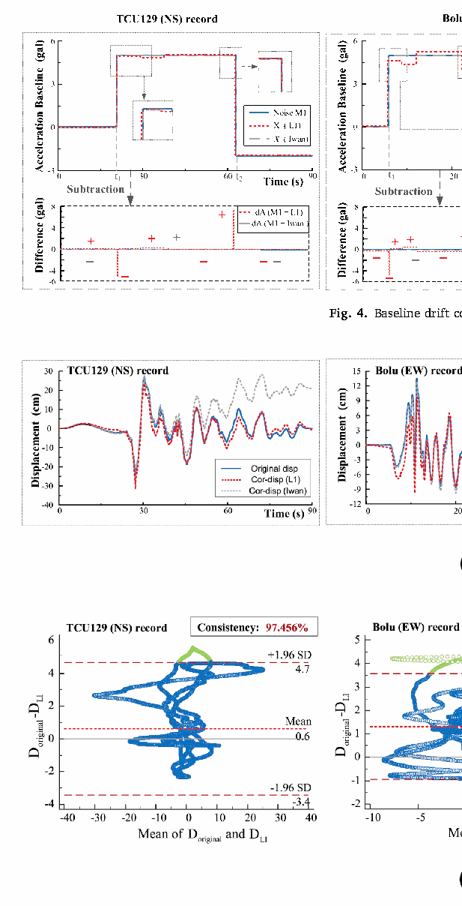
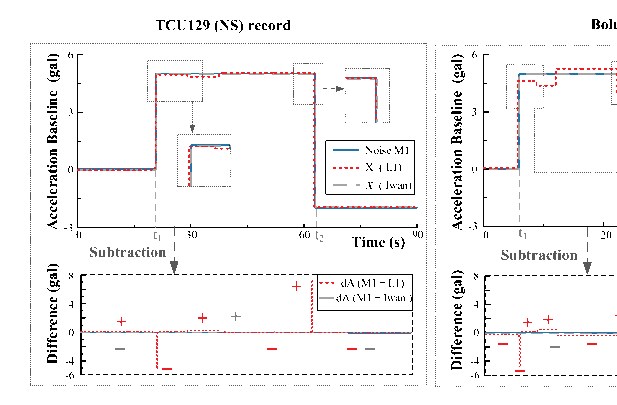
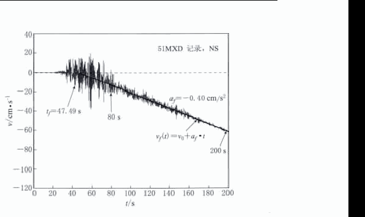
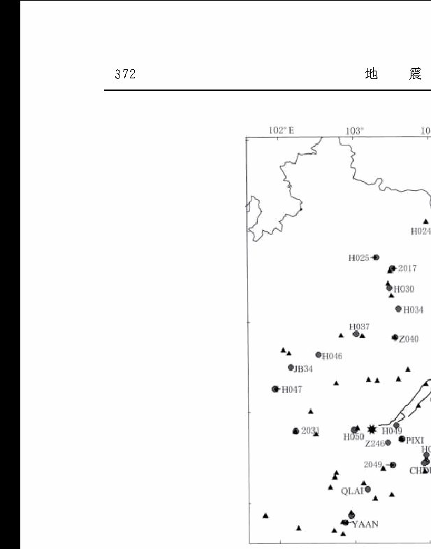
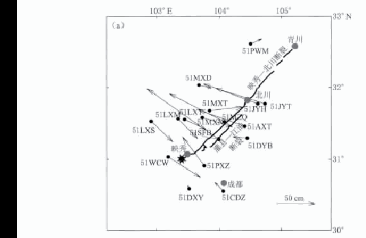
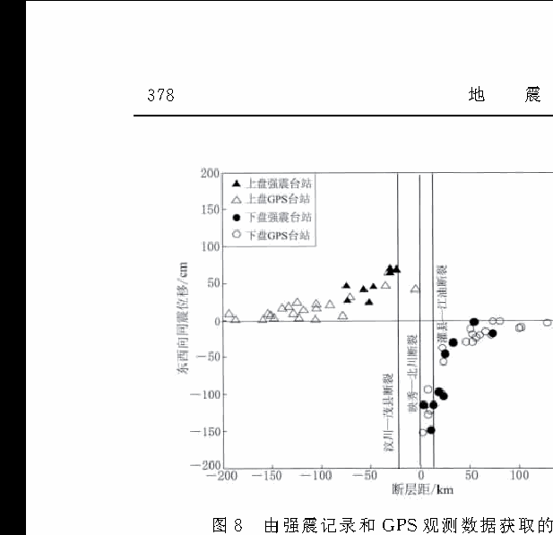

# 参考文献四篇，讲给你听（零基础版）

> 这份文件是给"完全没接触过这个方向"的人写的口头讲解稿：不用公式，先讲故事，再给关键数字，最后告诉你"这一篇到底要你记住什么"。
>
> 每一条结论后面都标了来源（页码 + 块号，如 `p.4 S005`）。想核对原文，就到对应精读目录的 `paper.md` 里搜这个块号，或到 `source_map.json` 里查页码。
>
> 需要先补的 14 个前置概念见 [`基础概念速查.md`](基础概念速查.md)；阅读节奏见 [`00_从基础开始阅读指南.md`](00_从基础开始阅读指南.md)。

---

## 0. 先把一件事讲明白：什么叫"基线漂移"

### 0.1 一个生活里的类比

地震仪记录的不是"地面震了多远"，而是**地面震动的加速度**（EW / NS / UD 三个方向，合称三分量，见 [`基础概念速查.md`](基础概念速查.md) 第 1 条）。

可我们要的东西是另一个：**地面最后停在了哪里**（永久位移）。

要拿到位移，只能积分两次：加速度 → 积分 → 速度 → 再积分 → 位移。

麻烦就在这里。地震仪记录里有一个几乎看不见的"零点偏差"——就像一台电子秤每次都多称 0.01 公斤。你称一次根本发现不了，但如果你拿它去累计一整天吃进去多少东西，误差就会滚雪球。

### 0.2 滚雪球有多快

地震界最常被引用的一句话（Chiu, 1997，被 2019 与 2020 两篇论文的引言同时引用）：

**0.01 gal 的加速度漂移持续 60 s，会让速度产生 0.6 cm/s 的误差，让位移产生 18 cm 的误差。**

（`1 gal = 1 cm/s²`，0.01 gal 约等于重力加速度的十万分之一。）

来源：`01_Xiong2019_.../paper.md` p.2 S003；`03_Dai2020_.../paper.md` p.1 S002。

为什么是"雪球"而不是"线性增长"？因为常数偏移积分一次变成一条**一直往上爬的斜线**，再积分一次变成一条**越走越陡的抛物线**。误差近似按时间平方增长。

你手上的 [`experiments/drift_demo.py`](experiments/drift_demo.py) 就是专门复现这件事的，跑出来的图是 [`experiments/drift_demo.png`](experiments/drift_demo.png)：

它的四组结果，正好把后面四篇论文的关键词全覆盖了：

| 实验 | 数字 | 对应论文里的哪句话 |
|---|---|---|
| A：常数漂移 0.01 gal | 位移末值误差 +18.0 cm | 所有论文的引言动机 |
| B：20 s 处加入 1 gal 阶跃漂移 | 位移末值误差 +800 cm | "加速度是阶梯 → 速度是折线 → 位移是抛物线" |
| C：对阶跃漂移做 v₀ 型校正 | 误差从 800 cm 压到 −13 cm | 谢俊举 2013 用的就是这类方法 |
| D：尾部速度没归零时做同样校正 | 误差反而 −762 cm | "地震动结束后速度应趋于零"这条判据为什么必须成立 |

### 0.3 术语对照（本文件统一用右边这一列）

| 本文用法 | 英文/符号 | 一句话解释 |
|---|---|---|
| 基线漂移 / 基线偏移 | baseline drift / offset | 加速度记录的零线被"抬走"或"压低"了 |
| 事前部分 | prior part / pre-event part | P 波到达之前那段记录，理想情况下应是稳定零线 |
| 时间点 $t_1$、$t_2$ | — | 漂移的开始时刻与结束时刻 |
| PGV / PGD | — | 峰值速度 / 峰值位移 |
| L1 / L2 范数 | L1 / L2 norm | 绝对值之和 / 平方和开根号，详见第 3 节 |
| v₀ 方法 | Boore's $v_0$ method | 用速度末尾拟合直线与零线的交点定漂移起始时刻 |

---

## 1. 这四篇是什么关系（先看地图再看细节）

它们不是四篇互不相干的论文，而是**同一个问题的四个阶段**：

| 顺序 | 论文 | 角色 | 一句话 |
|---|---|---|---|
| ① | 张斌、俞言祥（2022）综述 | **地图** | 这个领域有什么问题、有哪些解法、还缺什么 |
| ② | 熊政辉等（2019）中文方法论文 | **新工具（初版）** | 用 L1 稀疏优化，让算法自己决定"漂移分几段" |
| ③ | Dai 等（2020）SDEE 英文论文 | **新工具（正式版）+ 验证** | 公式写严谨，还搭了振动台+相机做物理验证 |
| ④ | 谢俊举等（2013）汶川论文 | **产品说明书** | 三分量记录怎么变成位移场，并拿 GPS 对答案 |

建议按 ①→②→③→④ 的顺序读。这也是 [`README.md`](README.md) 推荐、[`00_从基础开始阅读指南.md`](00_从基础开始阅读指南.md) 细化过的顺序。

---

## 2. 第一篇：张斌、俞言祥（2022）《近场强震动记录基线校正方法》

### 一句话

**这是一篇"地图"：它不提出新方法，而是把"漂移从哪来、怎么算合格、有哪些解法、还缺什么"一次讲清。**

出处：地球与行星物理论评，2022，53(2)：204–213。精读：`02_Zhang2022_近场强震动基线校正综述/paper.md`。

### 2.1 漂移从哪来：作者给了一张二分法（最重要）

第 1 节把原因分成两类（p.3–4，S004–S006）：

**（一）低频误差**：仪器噪声、恒定偏移、背景噪声、初始值、操作误差等。这一类是"电子设备自己的毛病"。

**（二）地面倾斜或旋转**：地震时近场地面破裂、隆起，把强震仪"歪"了一下。仪器一歪，重力就被"漏"进水平方向的记录里。这一类是"物理世界造成的"。

为什么这个二分法这么重要？因为它直接决定"你能不能把三个方向各跑一遍了事"。作者给了一组非常关键的数字（p.4，S005）：

| 情形 | 等效基线偏移 | 60 s 后累积的位移误差 |
|---|---|---|
| 倾斜 0.06°，**水平摆**（水平两轴） | 约 1 gal | 可达 **18 m** |
| 倾斜 0.06°，**垂直摆**（垂直轴） | 极小 | 只有 **0.9 mm** |

公式来源就在旁边：水平方向是 $\Delta g = g\theta$（正比于倾斜角本身），垂直方向是 $\Delta g = g\theta^{2}/2$（正比于倾斜角的平方）。θ 本身很小的时候，θ² 就是"小得可以忽略"——这就是为什么同样歪 0.06°，水平两轴被影响得厉害，垂直轴几乎无感。

**类比：** 端着一杯水稍微歪一点点。水面相对杯壁的"高度差"在水平方向上一眼就能看出来；而杯子整体"矮了那么一丁点"的高度变化，你一毫米都察觉不到。倾斜对水平摆和垂直摆的差别就是这个。

**由此得到一句话：三轴 ≠ 三次单轴。** 水平两个方向共享同一个"倾斜"物理来源，垂直方向几乎不受这个机制影响。这是后面所有三分量工作的立足点。

### 2.2 怎么算"校正合格"：两条判据

第 2.1 节给出全领域通用的两条验收标准（p.4，S007）：

1. 地震动结束后，**速度应趋于零**；
2. 位移时程的末尾段应**平行于时间轴**。

注意第 2 条的措辞：它是"平行"，不是"等于零"。意思是位移最后可以停在某个非零值上——那个值就是永久位移。**如果地面真的沉下去了（比如后面汶川论文里垂直向 −0.49 m），你必须把它留住，而不是拉回零。** 这一点是小白最容易读错的地方。

### 2.3 有哪些解法：两条路线，怎么选

第 2 节（p.4–8，S008–S016）把方法分两大类：

**（一）高通滤波路线。** 把低频成分滤掉。省事、客观，PEER 数据库的标准流程就是它。但代价致命：**漂移和永久位移处在同一个低频段，滤掉漂移的同时也把永久位移滤掉了**（S010）。所以大震近场记录不能用它。

**（二）分段校正路线。** 在速度时程上分段拟合直线，由直线的斜率反推加速度的漂移量。这条路线保得住永久位移，但需要回答"分几段、从哪一刻开始漂"这两个问题。

作者把这条路线的发展画成了一条链（S011–S015）：

Iwan（1985，用"加速度首次超过 50 gal"定 $t_1$）→ Boore 的 $v_0$ 方法（用速度末尾拟合直线与零线的交点定时刻）→ 各种改进（能量比、位移平坦度、时移斜率比……）→ 熊政辉等（2019）的 **L1 稀疏方法（自动定段）** → Tian 等（2019）的**三维倾斜校正 + 累积校正**。

配套的两张图很值得看：

（图 1，p.3：上面是加速度、中间是速度、下面是位移。漂移在加速度上几乎看不出来，到了位移就是一个明显的抛物线——这就是第 0 节讲的那件事的真实数据版。）

（图 2，p.6：Iwan 两段式的几何关系——加速度域是阶梯、速度域是折线、位移域是抛物线。看懂这张图，后面 2019 和 2020 那两篇的插图就都能看了。）

### 2.4 作者最后的结论

第 3 节（p.8–9，S017–S019）：

- **小震记录**：用高通滤波，最有效也最不主观；
- **大震近场记录**：必须用单段式或多段式校正，否则拿不到可靠的长周期地震动与永久位移；
- **领域还缺什么**：没有任何方法能定量分解"哪一部分漂移来自低频误差、哪一部分来自倾斜"；而且现在还测不到三分量的旋转记录。作者认为未来的方向是用大数据/机器学习，基于 Iwan 原理自动、快速地定出 $t_1$、$t_2$。

### 2.5 小白请记住

1. 漂移有两种来源，处理方式不同；
2. 水平两轴受倾斜影响是"一阶"的，垂直轴是"二阶"的——差好几个数量级；
3. 两条验收判据里，"平行于时间轴"允许永久位移存在；
4. 小震用滤波，大震近场用分段校正。

**要背的数字：0.06° → 水平 1 gal / 18 m，垂直 0.9 mm。**

### 2.6 容易读错的地方

- 以为滤波是"更高级的操作"：恰恰相反，越是要永久位移，越不能用滤波。
- 以为"位移末尾要回到零"：原文说的是"平行于零轴"。
- 以为综述里没有干货：它的干货就是分类体系和那组倾斜量级数字，是你写引言时的骨架。

---

## 3. 第二篇：熊政辉等（2019）《基于 L1 范数正则化的强震动加速度记录基线漂移识别方法》

### 一句话

**这篇论文解决的是"主观性"：以前要人判断"漂移分几段、从哪一刻开始"，现在把这两个决定交给优化算法自动做。**

出处：地震学报，2019，41(1)：111–123。精读：`01_Xiong2019_L1范数正则化基线漂移识别/paper.md`。

### 3.1 它要打的痛点

引言（p.2–3，S004）说得很直白：传统方法里"漂移几次、什么时候漂"这些参数**往往凭主观经验给定**。不同的人处理同一条记录，可能给出不同的漂移模型。

作者的方案：让算法自己决定。目标函数（p.4，式 (1)）长这样：

$$\min_x f(x) = \|Ax-b\|_2 + \lambda\|x\|_1$$

翻译成白话：**"让速度拟合得尽量准（第一项）" + "让求出来的基线尽量'干净'（第二项）"。** 式中的 $b$ 是待拟合的速度，$x$ 是要求解的基线漂移，$A$ 是把基线映射到速度的算子，$\lambda$ 是平衡两者的系数（本文取 1）。

### 3.2 L1 和 L2 到底差在哪（这是最关键的一节，请慢读）

同一件事，用 L2 惩罚和用 L1 惩罚，得到的答案是两种性格：

- **L2（平方）**喜欢"大家都很小、雨露均沾"：错误被分散到所有时间点上，基线会被抹成一条平滑曲线。
- **L1（绝对值）**喜欢"绝大多数正好是零，少数很大"：**大扫除式的结果**——它倾向于把大量不重要的分量直接压成 0，只在少数位置保留非零值。

这在数学上叫**稀疏**。而"稀疏"恰好和物理假设对得上：漂移不是一直在慢慢挪，而是**在少数时刻突然跳一下，然后保持不动**（阶梯状）。

所以 L1 方法的输出天然是"分段的阶梯基线"——分几段不用你告诉它，它自己算出来。

> ⚠️ 一个重要澄清：熊政辉 2019 中文版把正则项写成 $\|x\|_1$（对基线本身），而 2020 英文版明确写成 $\|y\|_1$，其中 $y_i = x_{i+1}-x_i$（对基线的**差分**，也就是"跳变"）。**这两者的解完全不同**：前者抑制的是"基线幅度大"，后者抑制的是"跳变次数多"，只有后者才会给出阶梯状基线。复现时请以英文版为准。

### 3.3 实验是怎么设计的：一场"开卷考试"

真实地震记录里，我们**并不知道**真实漂移是多少，所以没法直接判断方法准不准。作者的做法很聪明（p.4–6，S012–S013）：

拿真实的干净记录，**人为加入已知的漂移**（单段式、两段式、多段式三种，幅值写着 5 gal、−2 gal 等），然后让算法去把它们"找出来"，最后跟标准答案比对。

这就是"开卷考试"：有标准答案，才能给方法打分。

三条测试记录是刻意挑的，为的是把"事前部分长度"这个变量拉开（p.5，表 1）：

| 台站 | 地震 | 事前部分 |
|---|---|---|
| El Centro Array #9（NS） | 1940 帝王谷 | **0.04 s**（几乎等于丢头） |
| Bolu（EW） | 1999 迪兹杰 | **5.39 s** |
| TCU129（NS） | 1999 集集 | **20.65 s**（很充足） |

（图 1，p.5：单段式、两段式、多段式三种人工漂移噪声的形状。$t_1$ 是开始漂的时刻，$t_2$ 是第二次跳变的时刻，$t_e$ 是记录结束。）

### 3.4 结果：误差大小几乎就是按事前部分排队

（p.6–8，S015–S020；定量数字在 2020 英文版里给得更干净）

| 记录 | 识别出的漂移与真值的偏差 | 起始时刻偏差 |
|---|---|---|
| TCU129（事前 20.65 s） | 几乎完全重合（<0.1 gal） | 0.1 s |
| Bolu（事前 5.39 s） | 约 1.17 gal | 0.1 s / 0.3 s |
| El Centro（事前 0.04 s） | 约 1.39 gal | 起始时刻滞后约 0.5 s |

而**速度**的恢复几乎不受影响：El Centro 原始 PGV 是 −29.66 cm/s，加了三类噪声后算法恢复出 −30.66、−30.66、−30.53 cm/s——误差约 1 cm/s，约 3%（p.8，S020）。

**一句话总结这篇论文：速度恢复很稳，位移恢复看事前部分。**

### 3.5 "拉向零线"是什么意思（这是这篇论文最需要理解的现象）

El Centro 记录前 0.8 s 的均值是 5.8 m/s²（按论文正文的写法；按该领域惯例应是 gal 量级，见下面"容易读错的地方"），也就是**记录一开始就不在零线上**。

算法内部有一个假设："地震前的基线应该是零。" 当它看到一段本该是零、实际却不是零的初始记录时，就会**强行把这段位置往零线拉**，顺手也带走了一部分真实信号，导致最终位移偏小（p.6，S016）。

（图 3，p.8：黑线是原始记录，红线是算法识别出的基线，可以看到初始段被"拉拢"到零线附近。）

理解这一点有两个用处：一是明白"事前部分为什么重要"；二是明白**垂直分量不能这么处理**——如果那个台站真的沉降了，被拉回零就等于把真实沉降抹掉了。

### 3.6 作者自己留下的开放问题

结论 3（p.11–12，S024）最后一句：$\lambda$ 是一个模型相关的超参数，不同的取值会直接改变结果，**"但如何获取合适的超参数值一直是个难题"**，后续会继续研究。

小白只需知道：这是作者亲手留出来的缺口，也是后面可做的题目之一。

### 3.7 小白请记住

1. 它把"漂移分几段"从人工判断变成了优化结果；
2. L1 = 稀疏 = 大扫除，所以基线是阶梯状；
3. 事前部分越长，**位移**越准；**速度**几乎不受影响；
4. "拉向零线"是事前部分不足时的系统性副作用。

### 3.8 容易读错的地方

- **单位坑**：论文正文把漂移阈值和幅值写成 m/s²，但按图轴量级以及 2020 英文版的写法（5 gal、−2 gal），这里应是 **gal（cm/s²）**。差 100 倍，复现前必须先确认。
- **正则项位置坑**：中文版写 $\|x\|_1$，英文版写 $\|y\|_1$，两者结果不同（见 3.2）。
- 以为 L1 是"让基线整体变小"：它真正抑制的是"跳变"，不是"幅度"。
- 样本量很小：每种噪声模型只有三条记录，"事前部分越长越好"这个结论方向正确，但严格来说还需要更多数据统计验证。

---

## 4. 第三篇：Dai 等（2020）*Baseline correction based on L1-Norm optimization and its verification by a computer vision method*

### 一句话

**这是同一套方法的"正式论文版"：公式写严谨了，和经典 Iwan 方法做了同数据定量对比，还搭了一套振动台+相机来"眼见为实"。**

出处：Soil Dynamics and Earthquake Engineering, 131 (2020) 106047。精读：`03_Dai2020_SDEE_L1优化与视觉验证/paper.md`（四篇里唯一的**全文段落级中英对照**）。

> 注：这篇的 PDF 在你工作目录里有两份（根目录与 `参考文献/` 各一份），是同一篇论文。

### 4.1 相对 2019 中文版，多了三样东西

**(1) 公式落到了"差分"上。** 论文定义（p.2，式 (1)、式 (2)）：

$$y_i = x_{i+1}-x_i,\qquad \min_x f(x)=\|Ax-b\|_2+\lambda\|y\|_1$$

$y$ 是基线的差分向量，长度是 $n-1$。**"$y$ 稀疏"= "基线只在少数时刻跳变"= 阶梯状基线。** 这一句把 2019 里含糊的地方钉死了。（对应 `paper.md` 的 E001、E002 块。）

作者还补了一句很关键的物理动机（p.2，S016）：**地震期间的倾斜被认为是一种"稀疏现象"**——不是持续发生，而是偶尔发生。稀疏优化恰好匹配这个物理直觉。

**(2) 与 Iwan 方法同数据、同指标的比较。** 三条记录、两种方法、同一个"已知人工噪声"标准答案（p.3–6，S025–S033）。

**(3) 视觉验证。** 详见下一节。

### 4.2 视觉验证：让相机来当裁判

前面所有验证都有一个软肋：所谓"参照位移"来自 PEER 的已处理记录，而那本身也是"某个方法算出来的"，等于"方法 vs 方法"。

所以作者在三轴振动台上做了一次真实物理实验（p.6–8，S038–S043）：

- 把 TSA-SMA 加速度计**用螺栓固定**在振动台上；
- 台子按调幅后的 El Centro 波和 Taft 波振动；
- 台外架一台 Nikon D7100 相机（1920×1080 像素、60 帧/秒）拍靶标；
- 用 C++ + OpenCV 把视频里的靶点轨迹换算成**真实位移**；
- 最后比较："由加速度积分算出来的位移" vs "相机亲眼看到的位移"。

结果：两条曲线的相关系数分别是 **97.34%** 和 **95.68%**，频谱几乎一致、主峰频率相同（p.8，S043）。

（图 9，p.7：时域和频域的对比。Iwan 方法得到的位移在低频段出现明显异常，L1 方法与视觉观测吻合良好。）

### 4.3 顺便学一个工具：Bland-Altman 图（小白很值得学）

论文用 B-A 图（一致性分析图）来比较两组位移曲线，得到相关系数 **97.456%、96.825%、95.420%**（分别对应 TCU129、Bolu、El Centro，p.5，S034）。

（图 5，p.5：左边是不同方法校正后的位移曲线对比，右边是 B-A 一致性分析图。）

**为什么不能只看相关系数？** 相关系数衡量的是"两条曲线是不是同涨同跌"，跟"数值是否相等"无关。举例：两个人每天体重差恒定为 2 kg，他们的体重相关系数依然可以是 0.99——相关性很高，但一致性很差。B-A 图画的正是"两条曲线之差"，才能回答"到底差多少"。

（图 4，p.5：三种台站下，已知人工噪声、Iwan 方法识别的漂移、L1 方法识别的漂移三条线放在一起。TCU129 那一行几乎完全重合，是最漂亮的一行。）

### 4.4 结论，以及一句必须记住的限定

结论（p.8–9，S044–S047）：

1. 事前部分越长，识别漂移的位置和幅度越准；事前部分过短且非零时，会把加速度"拉"向零线；
2. 单段、两段、多段都能自动识别，不用预设段数；对"速度斜率的趋势变化"比人工判断更敏感；
3. 速度恢复（尤其是 PGV）几乎不受事前部分影响；位移恢复则高度依赖事前部分。

方法定位（p.8，S044）：**本质上是对 Boore $v_0$ 方法的升级**——同样用分段线性拟合速度，但把"分几段"从人工改成优化求解。

还有一句必须记住的限定（第 5 节，p.8–9，Fig. 11 段）：

> **任何基线校正方法都不可避免地会压制地震信号，使校正得到的位移幅值小于真值。**

这句话的意思是：不要指望"校正后的位移"就是"绝对真实的位移"，它系统性地偏小。做任何新方法时，都要把它当对照项。

### 4.5 小白请记住

1. 这是这套方法的**标准定义文献**，公式要看这篇；
2. 正则项作用在**差分** $y$ 上，不是基线本身；
3. 视觉验证 = 用相机当裁判，绕开"用方法的输出验证方法"的循环；
4. 校正会让位移幅值偏小，这是系统性代价，不是 bug。

### 4.6 容易读错的地方

- 以为相关系数 97% 就等于"精度很高"：幅值仍可能系统性偏小，相关性看不出来。
- 以为 $\lambda=1$ 有严格推导：论文依据的是文献惯例与前人示例（p.3，S024），没有做敏感性分析——这正是 2019 作者自己承认的开放问题。
- 以为字典矩阵 $A$ 有明确定义：论文只说它是"完备字典"，**没有给出元素级构造**。复现时要自己把它写清楚（这一步本身就是一个可做的小题目）。

---

## 5. 第四篇：谢俊举等（2013）《利用强震数据获取汶川地震近断层地面永久位移》

### 一句话

**这篇不追求方法创新，它示范的是"最后交付物长什么样"：64 个台站的三分量记录 → 逐分量校正 → 永久位移 → 和 GPS 逐台对答案 → 画出位移场。**

出处：地震学报，2013，35(3)：369–379。精读：`04_Xie2013_汶川近场永久位移/paper.md`。

### 5.1 它用的方法：非常简单的一招

方法只有一句话（p.4，S007、式 (1)）：在**速度时程的末尾段**拟合一条直线 $v_f = v_0 + a_f t$。

- 这条直线与时间轴（零线）的**交点** → 漂移开始的时刻 $t_f$；
- 这条直线的**斜率** $a_f$ → 加速度的漂移量；
- 在相应时间段里把 $a_f$ 减掉，校正完成。

这就是前面反复出现的 **v₀ 型校正**，也是 Boore（2001）路线的做法。它只定"一段"，比 Iwan 两段式还简单。你在 [`experiments/`](experiments/README.md) 的实验 C 里已经亲手跑过它的效果：把 800 cm 的位移误差压到 13 cm。

**它和 2019/2020 的 L1 方法差在哪？** 只差一件事：那个"交点"是**一条直线**定出来的，还是用**稀疏优化在整段速度上自动解**出来的。所以只要你把 L1 方法接到同一批数据上，就能和这篇论文的结果直接对比——这就是这两篇论文能连起来读的原因。

（图 2，p.5：以 51MXD 台速度时程为例，拟合末尾段直线，交点给出漂移起始时刻，斜率给出漂移量。这张图就是整篇文章的方法。）

### 5.2 数据规模：这才是"大样本"

（p.3，S004–S005）

- 汶川主震共记录到 **420 组**震相完整的三分量记录；
- 本文挑出靠近映秀—北川主断裂的 **64 个强震台站**的三分量记录；
- 与 **41 个 GPS 站**的同震位移对比；
- 仪器是 ETNA 与 MR2002，量程 ±2g、18 bit、采样率 200 或 500 点/秒。

64 台 × 3 分量 = 192 条时程，加上独立真值（GPS）。这就是三分量方法的理想测试形态。

（图 1，p.4：三角形是强震台，圆点是 GPS 台。配对点离得越近，位移对比越可靠。）

### 5.3 结果：汶川近断层是怎么动的

（摘要 S001；结论 S013）

- 以映秀—北川断裂为界，**上盘和下盘做相向运动**，东西方向的位移大于南北方向；
- 下盘的 51SFB、51MZQ、51JYH 台东西向位移均为负（向西），其中 **51SFB 最大，达 1.49 m**；
- 上盘的 51WCW 台向东，位移 **1.26 m**；
- 大的永久位移集中在断裂附近的狭长范围内，离开发震断裂衰减很快。

（图 7，p.9：左图是用强震记录算出的水平位移，右图是 GPS 观测。箭头方向 = 位移方向，箭头长度 = 位移量。）

（图 8，p.10：横轴是断层距，纵轴是东西向位移。用这种剖面图检验"位移随断层距衰减"的整体规律，比单台对比更有说服力。）

### 5.4 垂直分量：这篇论文最重要的提醒

51SFB 台的**垂直向永久位移是 −0.49 m（向下沉降）**。这个数字和 GPS 参考台的 0.12 / 0.22 m 差别很大，但**与该处断层附近地质考察得到的 0.5–0.6 m 是吻合的**（p.7，S010）。

原因：那个 GPS 参考点离断层更远，位移衰减得更快——差异来自"参考点空间不一致"，不是方法算错了。

**对三分量方法的启示：垂直向的真实沉降是信号，不是漂移。** 如果对垂直分量也套用"把初始/末尾拉回零"的策略，就会把真实沉降抹掉。

### 5.5 验证的现实约束（这段决定了你以后怎么写结论）

作者非常诚实地交代了验证的局限（p.7–8，S011–S012；p.9–10，S014）：

- 12 个对比台站里，只有 **51PXZ（0.3 km）、51MXD（0.3 km）、51WCW（3.7 km）** 这几个 GPS 参考点离强震台足够近；
- 对其它台站，只能"用 GPS 判断位移的大小范围和方向"，不能做定量比较；
- GPS 的"同震位移"由震前震后观测差得到，**里面含有震后蠕变**；而强震仪记录的只是触发到记录结束这段时间。两者本来就不完全可比。

所以一个"不吻合"的结果，至少有三种可能原因：方法误差、参考 GPS 含蠕变、台站与 GPS 点空间不一致导致的衰减差异。区分这三者，是写结论时的基本功。

精读目录里的**表 1**（p.8，12 台 × 三分量 × 两套观测）可以直接当作你以后论文里"验证表"的模板。

### 5.6 小白请记住

1. 方法很朴素（单段 v₀ 型），价值在**流程和成品形态**；
2. 三分量是**逐分量**处理的，垂直分量不能被"拉回零"；
3. 定量验证只能靠近距离 GPS 配对，远距离配对只能定性；
4. 位移量的正负号约定必须与坐标方向严格一致——写反了整张矢量图就全反了。

---

## 6. 把四篇串成一个故事

如果你只有五分钟，就记住这条链条：

| 环节 | 谁在说 | 说什么 |
|---|---|---|
| 问题 | 2022 综述 | 漂移来自低频误差与地面倾斜；0.06° 就能在水平向造出米级位移误差；两条判据定"合格" |
| 工具 | 2019 中文论文 | 用 L1 稀疏优化自动决定"漂移分几段"，不再靠人 |
| 工具的正式版 + 验证 | 2020 英文论文 | 公式钉死在差分上；与 Iwan 同数据对比；用振动台+相机做物理验证；并承认校正会压低幅值 |
| 产品 | 2013 汶川论文 | 64 台三分量 → 逐分量 v₀ 校正 → 永久位移 → GPS/地质考察对比 → 位移场 |

再浓缩成一句话：

> **这是一个"看不见的小错误被放大成米级误差"的问题；解法从"人工选点"演化为"算法自动定段"；最终产物是一张台站三分量的永久位移场，并且必须用独立的物理观测（相机、GPS、地质考察）来证明它可信。**

---

## 7. 一页速查表

| 论文 | 一句话 | 必记数字 | 你要带走的结论 |
|---|---|---|---|
| 张斌、俞言祥 2022（综述） | 领域地图 | 0.06° 倾斜 → 水平等效 1 gal、60 s 累积 18 m；垂直仅 0.9 mm | 漂移二分法；两条判据允许永久位移；三轴 ≠ 三次单轴 |
| 熊政辉等 2019 | L1 自动定段（初版） | 三条记录事前部分 0.04 / 5.39 / 20.65 s；El Centro 起始时刻滞后 0.5 s | 速度恢复稳（PGV 误差约 3%）；位移恢复看事前部分 |
| Dai 等 2020 SDEE | L1 方法正式版 + 视觉验证 | <0.1 / 1.17 / 1.39 gal；B-A 相关系数 97.5 / 96.8 / 95.4%；视觉验证 97.34 / 95.68% | 正则项作用在差分 $y$ 上；校正必然压低位移幅值 |
| 谢俊举等 2013（汶川） | 三分量工程全流程 | 64 台三分量 + 41 个 GPS；51SFB 向西 1.49 m、垂直沉降 0.49 m | 垂直向沉降是信号；定量验证靠 <4 km 的近距 GPS 配对 |

---

## 8. 最容易把小白带偏的 6 个点

1. **以为 L1 是"让基线小"**：它让**跳变稀疏**，所以基线是阶梯状的。
2. **以为基线校正只是去噪**：它会压制真实地震信号，使位移幅值系统性偏小。
3. **以为三轴就是把单轴方法跑三遍**：水平两轴的倾斜漂移同源，垂直轴几乎不受倾斜影响。
4. **把垂直向的真实沉降当漂移抹掉**：汶川 51SFB 的 −0.49 m 是真信号。
5. **只看相关系数就宣布"精度高"**：相关性高 ≠ 幅值准，要配合 B-A 图和幅值误差。
6. **忽视单位与采样率**：gal 与 m/s² 差 100 倍；正则项的尺度也会随采样间隔变化。

---

## 9. 想动手的话，从这三步开始（由易到难）

1. **跑一遍实验**：打开 [`experiments/drift_demo.py`](experiments/drift_demo.py)，看漂移如何被两次积分放大，以及 v₀ 校正为什么会失效（实验 D）。半小时。
2. **复现 L1 单轴**：用 CVXPY 写 $\min_x\|Ax-b\|_2+\lambda\|y\|_1$，在 TCU129 上复现"误差 <0.1 gal"。
3. **三分量对比**：同一套代码把 EW / NS / UD 各跑一遍，得到三轴基线库；再试"让三个分量的跳变时刻尽量共享"，比较两者差异。

跨篇的疑问清单与后续研究设想，见 [`我的理解与疑问.md`](我的理解与疑问.md)。

---

## 10. 这四篇的本地文件与精读位置

| 论文 | 原始 PDF | 精读（原文摘录 + 逐节解读 / 中英对照） |
|---|---|---|
| 张斌、俞言祥（2022） | [近场强震动记录基线校正方法.pdf](../参考文献/近场强震动记录基线校正方法.pdf) | [`02_Zhang2022_近场强震动基线校正综述/paper.md`](02_Zhang2022_近场强震动基线校正综述/paper.md) |
| 熊政辉等（2019） | [基于 L1 范数正则化的强震动加速度记录基线漂移识别方法.pdf](../参考文献/基于L1范数正则化的强震动加速度记录基线漂移识别方法.pdf) | [`01_Xiong2019_L1范数正则化基线漂移识别/paper.md`](01_Xiong2019_L1范数正则化基线漂移识别/paper.md) |
| Dai 等（2020） | [Baseline correction based on L1-Norm optimization (SDEE, 2020).pdf](../参考文献/Baseline-correction-based-on-L1-Norm-optimization-_2020_Soil-Dynamics-and-Ea.pdf) | [`03_Dai2020_SDEE_L1优化与视觉验证/paper.md`](03_Dai2020_SDEE_L1优化与视觉验证/paper.md) |
| 谢俊举等（2013） | [利用强震数据获取汶川地震近断层地面永久位移_谢俊举.pdf](../参考文献/利用强震数据获取汶川地震近断层地面永久位移_谢俊举.pdf) | [`04_Xie2013_汶川近场永久位移/paper.md`](04_Xie2013_汶川近场永久位移/paper.md) |

每篇的图件原图在各自目录的 `assets/figures/`，整页渲染在 `assets/pages/`；公式与源锚点在 `source_map.json`；术语取舍与裁切说明在 `translation_notes.md`。
