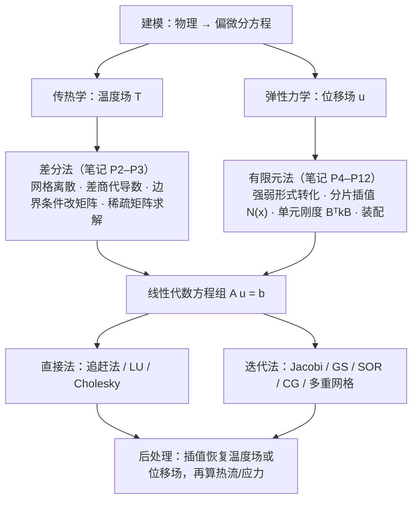

# 07 · 复习提纲与预习指引

> 面向 12 页原始笔记的**闭环复习**（查漏）+ **前瞻预习**（接上下一次课）。
> 复习部分建议先遮住答案自测；预习部分请提前把"工具"准备好，听课效率会完全不同。
> 注：第 8 次课（二维单元刚度矩阵、数值积分、总刚装配、边界条件、二阶 9 节点元）已整理为 [[08-二维单元刚度矩阵与总体装配]]，已覆盖下方 7.1 的数值积分与等参变换基础；三角形单元形函数见该篇末尾的预告（下次课内容）。

## 一、知识体系总览



两个主控方程的对照（同为"守恒律 + 本构关系"的产物）：

$$
\rho c\,\frac{\partial T}{\partial t}=\nabla\cdot k\nabla T+Q
\qquad\qquad
\frac{\mathrm d}{\mathrm dx}\left(ES\frac{\mathrm du}{\mathrm dx}\right)+\rho gS=0
$$

**一句话串起来**：两条路造出的是同一个代数方程组；差分法关注"算子离散得准不准"，
有限元法关注"基函数选得好不好"。二者都依赖线性代数求解器和误差分析。

## 二、核心公式速查表

### 2.1 差分部分

| 内容 | 公式 |
| --- | --- |
| 控制方程（瞬态导热） | $\rho c\,\partial T/\partial t=\nabla\cdot(k\nabla T)+Q$ |
| 稳态方程 | $\nabla\cdot(k\nabla T)+Q=0$ |
| 一维稳态 | $\frac{\mathrm d}{\mathrm dx}\left(k\frac{\mathrm dT}{\mathrm dx}\right)+Q=0$ |
| 向前/向后/中心差分 | $\frac{T_{i+1}-T_i}{h}$、$\frac{T_i-T_{i-1}}{h}$、$\frac{T_{i+1}-T_{i-1}}{2h}$（$O(h),O(h),O(h^2)$） |
| 二阶中心差分 | $\dfrac{T_{i+1}-2T_i+T_{i-1}}{h^2}+O(h^2)$ |
| 二维五点格式（常系数） | $4T_{i,j}-(T_{i\pm1,j}+T_{i,j\pm1})=h^2Q_{i,j}/k$ |
| 半节点系数（变系数） | $k_{i+\frac12}=\dfrac{2k_ik_{i+1}}{k_i+k_{i+1}}$（调和平均） |
| 虚拟节点（Neumann） | $T_0=T_2+\dfrac{2hq}{k}$（由 $-k\dfrac{T_2-T_0}{2h}=q$ 解出） |
| 矩阵性质 | 带状稀疏、对称正定、对角占优 $\|a_{ii}\|\ge\sum_{j\ne i}\|a_{ij}\|$ |

### 2.2 有限元部分

| 内容 | 公式 |
| --- | --- |
| 强形式（一般二阶 ODE） | $-\frac{\mathrm d}{\mathrm dx}\left(p\frac{\mathrm du}{\mathrm dx}\right)+qu=f$ |
| 弱形式（一维） | $\int_0^L p u'\bar u'\,\mathrm dx+\int_0^L qu\bar u\,\mathrm dx+\alpha u(L)\bar u(L)=\int_0^L f\bar u\,\mathrm dx+g\bar u(L)$ |
| 弱形式（二维 Poisson） | $\int_\Omega k\nabla u\cdot\nabla\bar u\,\mathrm d\Omega+\int_{\partial\Omega_3}\alpha u\bar u\,\mathrm dS=\int_\Omega f\bar u\,\mathrm d\Omega+\int_{\partial\Omega_2\cup\partial\Omega_3}g\bar u\,\mathrm dS$ |
| Green 公式 | $-\int_\Omega\nabla\cdot(k\nabla u)\bar u\,\mathrm d\Omega=\int_\Omega k\nabla u\cdot\nabla\bar u\,\mathrm d\Omega-\oint_{\partial\Omega}k\frac{\partial u}{\partial n}\bar u\,\mathrm dS$ |
| 线性形函数 | $N_{i-1}(x)=\dfrac{x_i-x}{l_i},\ N_i(x)=\dfrac{x-x_{i-1}}{l_i}$ |
| 应变矩阵 | $[B]=\mathrm d[N]/\mathrm dx=[-1/l_i,\ 1/l_i]$ |
| 单元刚度矩阵（1D 线性） | $[K]^e=\dfrac{ES}{l_i}\begin{bmatrix}1&-1\\-1&1\end{bmatrix}$ |
| 单元载荷向量（均布体力） | $\{f\}^e=\dfrac{\rho gSl_i}{2}\begin{bmatrix}1\\1\end{bmatrix}$ |
| 一般单元矩阵 | $[K]^e=\int_{e}[B]^\mathrm T p[B]\,\mathrm dx+\int_e[N]^\mathrm Tq[N]\,\mathrm dx$ |
| 总势能泛函 | $\Pi(u)=\int_0^L\frac{ES}{2}u'^2\mathrm dx-\int_0^L\rho gSu\,\mathrm dx-Pu(L)$ |
| 双线性形函数（Q4） | $N_k(x,y)=N_i(x)N_j(y)$，$\sum N_k\equiv1$，$N_k(x_j,y_j)=\delta_{kj}$ |
| 二维 $[B]$ | $[B]_{2\times4}=\begin{bmatrix}\partial N_k/\partial x\\ \partial N_k/\partial y\end{bmatrix}$ |
| 条件数 | $\mathrm{Cond}(A)=\dfrac{\lvert\lambda_{\max}\rvert}{\lvert\lambda_{\min}\rvert}=O(n^2)$（一维线性单元） |

## 三、必会推导清单

> 检验标准：合上笔记，在 10 分钟内独立写完。做不到就回到对应文件重看那一节。

| # | 推导内容 | 难度 | 对应笔记 |
| --- | --- | --- | --- |
| 1 | 用 Taylor 展开导出三种一阶差分与二阶中心差分，写出截断误差 | ★ | P2 |
| 2 | 由控制体能量守恒 + 散度定理推出 $\nabla\cdot(k\nabla T)+Q=0$ | ★★ | P2 |
| 3 | 写出变系数五点格式（半节点离散），并说明为何用调和平均 | ★★★ | P3 |
| 4 | 说明第一类边界条件处理后的矩阵为什么仍对称正定 | ★★ | P3 |
| 5 | 由弹性杆三套方程（几何、本构、平衡）写出强形式与两类边界条件 | ★ | P4 |
| 6 | 从强形式出发，用"乘检验函数 + 分部积分"推出弱形式，说清边界项消失的原因 | ★★ | P4、P8 |
| 7 | 证明 $\Pi(u)$ 取极小 ⟺ 弱形式（变分 $\delta\Pi=0$） | ★★★ | P4 |
| 8 | 算出 $[K]^e=\frac{ES}{l}\begin{bmatrix}1&-1\\-1&1\end{bmatrix}$ 与 $\{f\}^e$，并说明行和为 0 的物理意义 | ★★ | P6 |
| 9 | 用 Gauss 公式推出二维 Poisson 弱形式（含边界积分拆分） | ★★★ | P10 |
| 10 | 写出四个双线性形函数并验证单位分解与 Kronecker 性质，推出 $[B]_{2\times4}$ | ★★ | P11–P12 |

## 四、自测题（含答案要点）

**A 组：差分法**

1. 网格步长 $h=0.1$，用中心差分近似 $u'(1.0)$，已知 $u(1.1)=2.30,u(0.9)=2.10$，求近似值并估计截断误差量级。
   > 答案：$\approx1.0$；误差 $O(h^2)=O(10^{-2})$。
2. 一维稳态导热，$k=1$、$Q=0$、$T(0)=0$、$T(1)=1$，取 $n=3$（$h=1/3$，两个内点）写出方程组并求解。
   > 答案：$-2T_1+T_2=0$ 且 $T_1-2T_2=-1$（边界项移到右端），得 $T_1=1/3,T_2=2/3$，与精确解 $T=x$ 一致。
   > （若取 $n=2$ 则只有 1 个内点，方程退化为 $-2T_1+T_0+T_2=0$，得 $T_1=1/2$。）
3. 为什么变系数问题的半节点热导率要用调和平均？用两层串联热阻说明。
   > 答案：稳态串联热阻 $\frac{h/2}{k_1}+\frac{h/2}{k_2}$ 等效于 $\frac{h}{k_{\text{eff}}}$，解出 $k_{\text{eff}}=\frac{2k_1k_2}{k_1+k_2}$。
4. 写出五点格式的截断误差并说明为什么在非正方形网格上会变差。
   > 答案：$O(h^2)$；误差项含 $\frac{h_x^2}{12}T_{xxxx}+\frac{h_y^2}{12}T_{yyyy}$，两方向步长不等时系数不匹配，实际误差由较大步长控制。
5. 纯 Neumann 边界条件的稳态问题为什么解不唯一？怎么处理？
   > 答案：解可相差任意常数（矩阵奇异）；需附加一个第一类边界条件或额外约束（如平均值给定）。

**B 组：有限元法**

6. 为什么弱形式里可以出现导数不连续的分片线性函数？
   > 答案：弱形式两边都只有一阶导数，$H^1$ 允许一阶导数平方可积（可有跳跃点），分片线性满足。
7. 检验函数为什么要取 $\bar u(0)=0$？
   > 答案：消掉 $x=0$ 处含未知支座反力的边界项。
8. 写出线性单元 $[K]^e$ 并说明"行和为 0"的含义。
   > 答案：$\frac{ES}{l}\begin{bmatrix}1&-1\\-1&1\end{bmatrix}$；刚体平移（$u_1=u_2$）不产生内力。
9. 均布荷载 $\rho gS$ 在该单元的两个节点各分到多少？为什么是"各一半"而非其他分法？
   > 答案：各 $\frac12\rho gSl$；来自一致载荷向量 $\int[N]^\mathrm T\rho gS\,\mathrm dx$，其分量为 $\int N_i\,\mathrm dx=\frac{l}{2}$。
10. 装配后的总刚度矩阵为什么是三对角阵？
    > 答案：每个节点只与左右相邻节点耦合（分片线性基函数支集仅跨两个单元）。
11. 一般二阶 ODE 弱形式中，$x=L$ 处的 $\alpha u(L)\bar u(L)$ 项属于矩阵还是右端？为什么？
    > 答案：矩阵（含未知量 $u(L)$，左端项）；$g\bar u(L)$ 才是右端。
12. 写出二维 Poisson 弱形式，并说明第一类边界条件的边界积分为什么是零。
    > 答案：见速查表；因检验函数在该边界上为零。
13. 双线性形函数为什么不满足 $[N]^\mathrm T[N]$ 与 $[B]^\mathrm T[B]$ 相同？各自来源是什么？
    > 答案：前者来自质量型项 $\int q u\bar u$（或边界 $\alpha$），后者来自刚度型项 $\int p u'\bar u'$。
14. 网格加密一倍，一维线性单元刚度矩阵的条件数大约变化多少？有什么后果？
    > 答案：约变为 4 倍（$O(h^{-2})$）；舍入误差放大，应改用迭代法或更高阶单元。
15. 为什么矩形单元 $[K]^e$ 是 $4\times4$，而线性一维单元是 $2\times2$？
    > 答案：自由度数等于单元节点数：矩形单元 4 个节点各 1 个位移自由度，$[B]$ 为 $2\times4$，$[B]^\mathrm T[B]$ 为 $4\times4$。

## 五、最容易犯的错误（考前扫一眼）

1. 混淆"热流密度 $\boldsymbol q$"与"体热源 $Q$"（单位不同：$\mathrm{W/m^2}$ vs $\mathrm{W/m^3}$）。
2. 把"绝热边界（$\partial T/\partial n=0$）"写成"$T=T_0$"。
3. 第一类边界条件用"大数法"修改矩阵，导致条件数暴涨（编程时不推荐）。
4. 弱形式推导时漏掉边界项，或忘记 $\bar u$ 在 $\partial\Omega_1$ 上为零。
5. 把 $\int q[N]^\mathrm T[N]\mathrm dx$ 的系数误算成 $q l$ 或 $q l/2$（正确是 $ql/6\cdot[2,1;1,2]$）。
6. 装配时忘记"共用节点刚度相加"。
7. 三维/二维单元连接表节点顺序不一致，导致面积/体积符号错误。
8. 认为"解出 $\{u\}$ 就结束了"——忘了后处理（插值恢复、应力/热流计算）。

## 六、建议复习节奏（约 3~4 小时）

| 时段 | 任务 | 检查方式 |
| --- | --- | --- |
| 30 min | 通读 [[01-数学准备与离散思想|01]]、[[02-一维稳态热传导的有限差分法|02]]，默写差分三种格式与五点格式 | 速查表对照 |
| 45 min | 独立推导一维差分方程组（含第一类边界条件的处理），解一个 $n=3$ 的算例 | 与精确解比较 |
| 60 min | 通读 [[04-有限元法入门-一维杆件与变分原理|04]]、[[05-一维有限元-单元分析与装配|05]]，手推 $[K]^e$ 与 $\{f\}^e$ | 必会推导 #6、#8 |
| 45 min | 手推二维 Poisson 弱形式（Gauss 公式），写出四个双线性形函数 | 必会推导 #9、#10 |
| 30 min | 做 A/B 组自测题，标记不熟练项 | 错题回到对应 md |

## 七、预习指引（下一次课/下一章）

### 7.1 短期（下一次课很可能讲）：三角形单元与数值积分

| 准备项 | 具体内容 | 为什么需要 |
| --- | --- | --- |
| 面积坐标（重心坐标） | $L_1,L_2,L_3$，$L_i(x_j,y_j)=\delta_{ij}$，$\sum L_i=1$，$L_i=A_i/A$ | 三角形单元的形函数就是面积坐标 |
| 三角形上的积分公式 | $\int_\Delta L_1^{a}L_2^{b}L_3^{c}\,\mathrm dA=2A\dfrac{a!b!c!}{(a+b+c+2)!}$ | 单元刚度矩阵的解析积分 |
| Jacobi 矩阵与等参变换 | $\xi,\eta$ 参考坐标、$[J]=\partial(x,y)/\partial(\xi,\eta)$、$\mathrm d\Omega=\det[J]\mathrm d\xi\mathrm d\eta$ | 任意四边形/曲边单元 |
| Gauss 数值积分 | 一维两点/三点公式、二维张量积 | $[K]^e$ 一般无法解析积分 |

### 7.2 中期（教材后续章节）

| 主题 | 关键问题 | 教材 |
| --- | --- | --- |
| 二维弹性力学问题 | 平面应力/应变、弹性矩阵 $[D]$、$[K]^e=\int[B]^\mathrm T[D][B]\mathrm d\Omega$ | 姜礼尚第四章 |
| 极坐标与轴对称问题 | 圆域/环形域的单元构造 | 姜礼尚第四章 |
| 弱解的存在唯一性与误差估计 | Sobolev 空间、Lax-Milgram 定理、Céa 引理、$O(h)$/$O(h^2)$ 阶 | 姜礼尚第五章；附录（Cobolev 空间） |
| 特征值问题 | 结构自振频率 $[K]\{u\}=\lambda[M]\{u\}$、广义特征值算法 | 姜礼尚第六章 |
| 抛物型/瞬态问题 | 时间离散（显式/隐式/$\theta$ 法）、稳定性与 CFL 条件 | 张文生第 6 章 |
| 双曲型/波动问题 | 耗散与频散、CFL、伪谱法 | 张文生第 7 章 |

### 7.3 编程预习（强烈建议动手）

一维有限元程序骨架（把笔记的六步变成代码）：

```text
输入：n, L, E, S, ρg, P
1. 生成节点 x_i, 单元长度 l_i            ← 对应"离散"
2. for each element:
       Ke = ES/l * [[1,-1],[-1,1]]       ← [K]^e
       fe = ρgS*l/2 * [1,1]              ← {f}^e
3. 装配：A[2x2 块] → 全局 (n+1)×(n+1) 矩 ← "装配"
4. 边界：u_0 = 0（划行划列或改对角）      ← 第一类边界条件
5. 解 A u = f（追赶法 / numpy.linalg.solve）
6. 后处理：逐单元用 [N] 插值，算位移与应力 σ = E du/dx
```

二维扩展只需把"块矩阵"换成"节点连接表驱动的循环"（`elem` 文件），
并把 $[B]$ 从 $1\times2$ 改成 $2\times4$、$k$ 换成弹性矩阵或热导率。

### 7.4 预习自问清单

1. 三角形的三个面积坐标之和为什么恒为 1？
2. 等参元的形函数在参考坐标下写，积分为什么要乘 $\det[J]$？
3. 为什么 $q=0$ 且没有第一类边界条件时刚度矩阵奇异？（提示：刚体模态）
4. 二维问题按行编号与按列编号，带宽分别是多少？
5. 从笔记 P12 的 $[B]_{2\times4}$ 出发，写出 $[B]^\mathrm T[B]$ 的阶数，并说明它与 $[K]^e$ 的关系。

## 八、术语中英对照

| 中文 | 英文 |
| --- | --- |
| 有限差分法 | finite difference method (FDM) |
| 有限元法 | finite element method (FEM) |
| 弱形式/广义解 | weak form / generalized (weak) solution |
| 本质（强制）边界条件 | essential / Dirichlet / forced boundary condition |
| 自然边界条件 | natural / Neumann boundary condition |
| 形函数 | shape function |
| 单元刚度矩阵 | element stiffness matrix |
| 装配 | assembly |
| 单元连接表 | element connectivity table |
| 双线性单元 | bilinear (Q4) element |
| 等参元 | isoparametric element |
| 面积坐标 | area (barycentric) coordinate |
| 条件数 | condition number |
| 对角占优 | diagonal dominance |
| 追赶法 | Thomas algorithm / TDMA |
| 共轭梯度法 | conjugate gradient (CG) |
