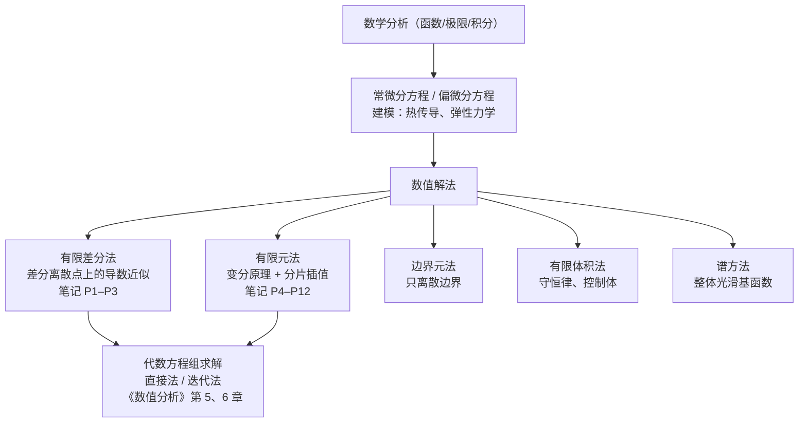

# 有限元分析 · 课堂笔记整理

> 来源：`有限元分析/笔记.pdf`（12 页手写课堂笔记，含 9 张黑板板书照片）
> 整理日期：2026-10-12
> 补充（2026-10-14）：第 8 次课的手写页与黑板板书照片在 `有限元分析(1).pdf` 第 13–15 页，
> 对应元宝录音《三角形网格形函数与等参元讲解》（99 分 28 秒），整理为 [[08-二维单元刚度矩阵与总体装配|08]] 篇。
> 参考书：`姜礼尚书-1.pdf`、`姜礼尚书-2.pdf`（本课程主教材，第一章 ~ 第六章）、
> `科学计算中偏微分方程有限差分方法.pdf`（张文生，高教社 2006）、
> `《数值分析》（第五版）李庆扬`（清华大学出版社）

## 一、这份整理包含什么

原始笔记是**速记式**的：公式跳步、符号混用、只有结论没有推导，黑板照片里的中间步骤没有抄下来。
本整理做三件事：

1. **还原**：按笔记原顺序逐页转写，公式写成规范的 LaTeX，符号统一（`u`/`T` 位移/温度，`k` 热导率，`E,S` 弹性模量/截面积）。
2. **补全**：把笔记跳过的推导补上——为什么用分部积分、为什么分片插值正好配变分原理、矩阵性质从哪来。
3. **延伸**：每条内容标注对应教材章节，并给出**复习**（自测/必会推导）和**预习**（下一节课、下一章）内容。

> **08 篇另加一件事——抄写板书照片。** 上述 1–7 篇只转写了手写页，
> 黑板照片里的中间步骤没有抄下来；08 篇把第 8 次课（二维单元刚度矩阵、数值积分、总刚装配、
> 边界条件、二阶 9 节点单元）的板书**逐张抄写**成 LaTeX，再按课堂录音补全推导。

## 二、文件索引

| 文件 | 对应原始笔记 | 主题 |
| --- | --- | --- |
| [[01-数学准备与离散思想]] | P1 | 课程地图、PDE 分类、四类数值方法、热对流扩散方程 |
| [[02-一维稳态热传导的有限差分法]] | P2 | 控制方程→定解条件→Taylor 展开→三对角方程组 |
| [[03-二维差分与线性方程组性质]] | P3 | 变系数五点格式、边界条件的矩阵处理、矩阵四性质 |
| [[04-有限元法入门-一维杆件与变分原理]] | P4 | 杆件离散模型→强形式→内积形式→弱形式 |
| [[05-一维有限元-单元分析与装配]] | P5–P7 | 分片插值、单元刚度矩阵、装配、求解、后处理、二次单元 |
| [[06-一般二阶ODE与二维Poisson有限元]] | P8–P12 | 一般二阶 ODE、弱形式解法、二维 Poisson、Green 公式、矩形双线性单元 |
| [[07-复习与预习]] | 全部 | 公式速查表、必会推导清单、自测题、预习路线 |
| [[08-二维单元刚度矩阵与总体装配]] | P13–P15 板书 | 二维 `[K]^e`、数值积分、总刚装配、边界条件两步法、二阶 9 节点元、三角形网格/等参元预告 |

原始笔记页图片在 `原图/笔记-01.jpg` ~ `笔记-12.jpg`，方便逐页对照。
第 8 次课（08 篇）的原件在 `C:/apps/codex/课程/课程/有限元分析/有限元分析(1).pdf` 第 13–15 页（含板书照片），库内不放大文件。

## 三、知识地图

## 四、笔记与教材对应表

| 笔记内容 | 主教材（姜礼尚） | 差分参考（张文生） | 数值代数（李庆扬） |
| --- | --- | --- | --- |
| PDE 与离散思想（P1） | 第一章 离散过程 | 第 1 章 预备知识 | 第 1 章 引论 |
| 一维稳态热传导差分（P2） | — | 第 2 章 差分近似与 Fourier 误差分析 | 第 5 章 解线性方程组的直接方法 |
| 二维差分、方程组性质（P3） | — | 第 3、4 章（稳定性、椭圆型方程） | 第 5、6 章 |
| 一维杆件例子、虚功方程（P4） | 第一章 §1（一个例子、1.1 离散模型） | — | — |
| 分片插值、基函数（P5–P7） | 第二章 插值与基函数 | — | 第 2 章 插值法 |
| 一般二阶 ODE 有限元（P8–P9） | 第一章、第二章 | 第 4 章 4.3（基于变分原理的差分） | — |
| 二维 Poisson、Green 公式（P10–P11） | 第二、三章（剖分与单元） | 第 4 章 椭圆型方程的差分方法 | — |
| 矩形双线性单元、B 矩阵（P11–P12） | 第三章（单元的构造） | — | — |
| 二维单元刚度矩阵、数值积分（P13–P14 板书） | 第三、四章 | — | 第 4 章（数值积分） |
| 总刚装配、第一类边界条件两步法（P14 板书） | 第一章、第三章 | — | 第 5 章（解线性方程组） |
| 二阶 9 节点单元、三角形网格/等参元（P15 板书，下次课） | 第三章 | — | — |
| 特征值/弹性力学（未讲到） | 第四、五、六章 | — | 第 8 章 |

> 说明：主教材扫描件没有封面页，文件名记为"姜礼尚书-1/2"，`-1` 是第一章（书页 1–66，两页拼一页扫描），
> `-2` 是全书（书页 1–310 左右）。上面表格里的章名是照扫描件正文标题核对过的。

## 五、怎么用这份整理

1. **先看原图**：`原图/笔记-XX.jpg` 扫一眼，回忆课堂上讲了什么（尤其是黑板照片，那里有完整推导）。
2. **再读对应 md**：重点看"补充推导"和"常见误区"两节，这才是笔记里缺的部分。
3. **做自测**：`07-复习与预习.md` 里每个模块都有自查题，能独立写出来=掌握了。
4. **往前看**：每篇末尾的"预习衔接"告诉你下次课会用到现在哪个知识点，提前把工具准备好（比如数值积分、面积坐标）。

> **格式说明**：全部公式采用 Obsidian 可识别的 LaTeX —— 行内用 `$...$`，独立公式用 `$$...$$`，
> 矩阵/方程组用 `bmatrix`、`cases`、`aligned` 环境；两处知识地图用 `mermaid` 流程图
> （Obsidian 原生支持）。剩余的代码块只有程序伪代码与 `node`/`elem` 文件格式示例，不是公式。

## 六、符号约定（全篇统一）

| 符号 | 含义 | 备注 |
| --- | --- | --- |
| $T$ | 温度 | 差分部分的主变量 |
| $u$ | 位移 | 有限元部分的主变量（弹性杆轴向位移） |
| $\rho, c, k$ | 密度、比热、热导率 | 热学参数；$k$ 也写作导热系数 |
| $Q, f$ | 热源项 / 方程右端源项 | $\rho c\,\partial T/\partial t=\nabla\cdot k\nabla T+Q$ |
| $E, S$ | 弹性模量、横截面积 | 杆件例子中 $ES$ 成对出现（轴向刚度） |
| $p(x), q(x), f(x)$ | 一般二阶 ODE 的系数与右端项 | $-(p u')'+qu=f$ |
| $P, q, g$ | 端部集中力 / 边界热流 / 边界给定值 | 第二、三类边界条件 |
| $[N],[B],[K]^e$ | 形函数行阵、应变矩阵、单元刚度矩阵 | $[B]=\mathrm{d}[N]/\mathrm{d}x$ |
| $\alpha$ | 换热系数（第三类边界条件） | 也写作对流系数 $h$ |
| $l_i,\,h$ | 单元长度 / 网格步长 | $l_i=x_i-x_{i-1}$ |
